# Платформа видеоаналитики: от MVP детекции курения к коммерческому продукту

**Руководство по архитектуре, данным, режимам работы и развитию**

Версия 1.0 · 10 октября 2026 · основа — состояние репозитория на коммите `0aa6569` (ветка `claude/amazing-bardeen-qy4tzf`)

> Документ самодостаточен. Он объясняет теорию задачи, разбирает текущую реализацию, предлагает целевую архитектуру двух режимов (режим разработчика и продукт оператора), модель хранения данных, макеты экранов, требования безопасности и права, дорожную карту и путь расширения на другие сценарии видеоаналитики. Числа взяты из прогонов проекта со ссылкой на источник; если что-то не измерялось, так и написано.

**Как читать.** Руководителю и заказчику хватит раздела 0 и разделов 7, 11, 13. Архитектору нужны разделы 2, 4, 5 и 8. ML-инженеру нужны разделы 1, 6 и 10. Разработчику интерфейса нужны разделы 6 и 7, в первую очередь 7.7 (UI/UX). Схемы лежат в `docs/img/platform/`: D — схемы, W — макеты экранов.

## Содержание

- [0. Резюме для руководителя](#0-резюме-для-руководителя)
- [1. Теория задачи](#1-теория-задачи)
- [2. Аудит текущего состояния](#2-аудит-текущего-состояния)
- [3. Анализ требований](#3-анализ-требований)
- [4. Целевая архитектура](#4-целевая-архитектура)
- [5. Данные: как хранить и обрабатывать](#5-данные-как-хранить-и-обрабатывать)
- [6. Режим разработчика (Dev Studio)](#6-режим-разработчика-dev-studio)
- [7. Продукт оператора: веб и десктоп](#7-продукт-оператора-веб-и-десктоп)
- [8. Технический стек и API](#8-технический-стек-и-api)
- [9. Безопасность, приватность, право](#9-безопасность-приватность-право)
- [10. Качество модели и MLOps](#10-качество-модели-и-mlops)
- [11. Расширение на другие сценарии видеоаналитики](#11-расширение-на-другие-сценарии-видеоаналитики)
- [12. Риски и меры](#12-риски-и-меры)
- [13. Дорожная карта](#13-дорожная-карта)
- [14. Приложения](#14-приложения)

---

## 0. Резюме для руководителя

**Что есть сейчас.** Работающий MVP распознаёт курение на записях уличных камер и выдаёт события по регламенту хакатона: кто курил (трек человека), когда, где (рамка) и с какой уверенностью.

Цепочка распознавания:
- поза и трекинг людей (YOLO26n-pose, BoT-SORT);
- ряд «расстояние запястье–рот»;
- автомат циклов жеста;
- классификатор цикла (ансамбль LogReg + LightGBM с признаками предмета у рта и zero-shot CLIP);
- правила события.

| показатель (31 клип, 60.6 мин, метки команды) | значение | источник |
|---|---|---|
| Event F1, режим реального времени (5 к/с) | **0.780** [0.67–0.91] · P 0.89 / R 0.70 | `docs/FINAL.md` |
| Event F1, режим качества (10 к/с) | **0.829** [0.74–0.94] · P 0.94 / R 0.74 | `docs/FINAL.md`, прогон `20261009_085252_mvp` |
| Честная оценка (вложенный подбор порога) | **0.74–0.76** | `docs/MVP.md` |
| Ложные тревоги | 0.99 в час по всем клипам, 0 на клипах без курения (0.45 ч) | `report.json` того же прогона |
| Скорость на ноутбуке i3 + iGPU | 1.23–1.33× реального времени на 1080p; 0.54–0.78 на 4K и плотных сценах | `docs/FINAL.md` |

Вокруг ядра уже есть:
- Streamlit-консоль разработчика (9 страниц);
- веб-приложение оператора (карта, тревоги, анализ видео, профили моделей);
- движок реального времени с SQLite-хранилищем тревог;
- пакеты решателя `.sdsolver.zip`;
- около 380 тестов.

Код — примерно 19.9 тыс. строк Python.

**Чего не хватает до коммерческого продукта** (подробно — в разделе 2):
1. **Доверие к качеству.** Все метки сделаны одним разметчиком, всего 23 эпизода, обучение и оценка идут на одних клипах. Дальних ракурсов 80–200 px, где ожидается основная часть реальных камер, в данных почти нет.
2. **Безопасность.** Нет входа и ролей, нет защиты от CSRF. Через `GET /api/profile/<name>` можно прочитать произвольный YAML-файл. Карта загружается с внешних CDN.
3. **Архитектура.** CLI занимает 1769 строк. Есть три параллельных стека обучения. Обучающий набор собирается из «последнего прогона». Задачи веба живут в памяти процесса. Тяжёлая работа в Streamlit блокирует сессию.
4. **Продукт.** Нет городов как сущности, нет истории решений (решение оператора перезаписывается), нет SLA, разбора смен, отчётов, уведомлений, демо-режима и десктопа.
5. **Право.** Модели Ultralytics распространяются под AGPL-3.0, VideoMAE — под CC-BY-NC. Часть открытых датасетов разрешена только для исследований. Видео с людьми — персональные данные (152-ФЗ).

**Что предлагается.**
- **Одно ядро, два режима** (схема D5):
  - режим разработчика — Dev Studio на Streamlit: валидация с PDF-отчётом, анализ кэша, разметка, признаки, обучение, выпуск;
  - продукт оператора — SPA на FastAPI, в браузере и как десктоп-приложение pywebview + PyInstaller: города, очередь событий, карточка с объяснением, подтверждение или опровержение с причиной, разбор, отчёты, демо для заказчика.
- **Данные** (раздел 5):
  - артефакты адресуются по содержимому (sha256), с манифестами;
  - метки версионируются, история решений хранится только добавлением;
  - БД: SQLite на одном узле, PostgreSQL для нескольких объектов.
- **Платформа сценариев** (раздел 11): общий контракт «восприятие → сигналы → сценарий → событие → оператор». Курение становится первым плагином; распитие, падение, отсутствие СИЗ, скопление, оставленный предмет добавляются без переписывания продукта.

**Пять главных рисков:** качество на дальних камерах, мало эталонных данных, лицензия AGPL, отсутствие защиты веб-API, персональные данные. Меры — в разделе 12.

**План** (раздел 13), шесть этапов, ≈ 20–30 человеко-недель до коммерческого пилота на одном объекте:
- E0 — гигиена;
- E1 — ядро и данные;
- E2 — Dev Studio;
- E3 — продукт оператора (веб);
- E4 — десктоп и демо;
- E5 — второй сценарий.

---

## 1. Теория задачи

### 1.1. Что считается событием

Задача — не «классифицировать кадр как курение», а найти **эпизоды курения конкретного человека во времени**. Событие описывается так:

| поле | смысл |
|---|---|
| `person_track_id` | один человек; разные люди никогда не склеиваются |
| `start_sec`, `end_sec` | границы эпизода |
| `peak_sec` | момент, в который сверяется рамка человека |
| `x1..y2` | рамка человека целиком в `peak_sec` |
| `confidence` | уверенность эпизода, с ней сравнивается порог |

**Регламент** (руководство хакатона, `docs/ANALYSIS.md`):
- **Цикл жеста:** рука идёт ко рту → пауза у рта 0.5–5 с → рука отводится.
- **POSITIVE:** два полных цикла за 20 с, либо один цикл и прямой признак (предмет или дым).
- **Склейка:** циклы одного человека с разрывом не больше 15 с объединяются в один эпизод.
- **IGNORE:** человек ниже 80 px. Предсказание, которое на 50 % и больше лежит в IGNORE-интервале, не считается ложным.

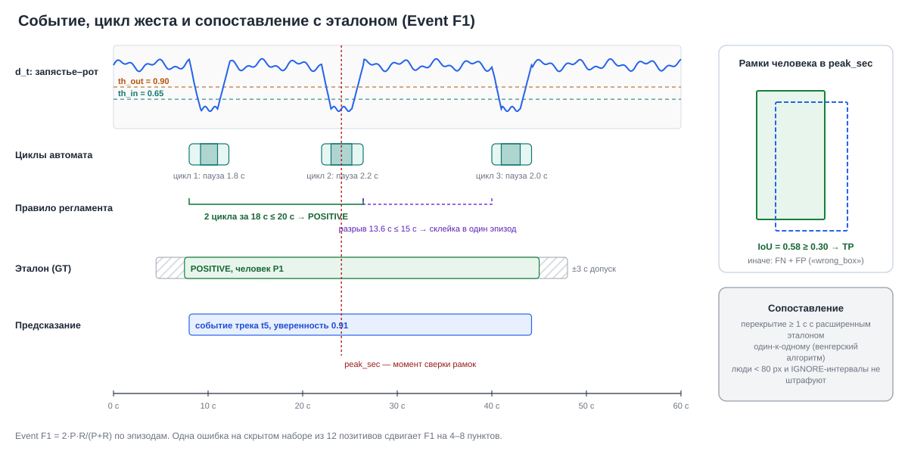

*D1. Ряд d_t, найденные автоматом циклы, правило «2 цикла за 20 с», склейка ≤ 15 с, эталон с допуском ±3 с и сверка рамок в `peak_sec`.*

### 1.2. Метрика Event F1

Предсказание совпадает с эталонным эпизодом, если выполнены все условия:
1. интервалы перекрываются не меньше чем на 1 с после расширения эталона на ±3 с;
2. рамки человека в `peak_sec` имеют IoU ≥ 0.30;
3. пара не занята: сопоставление один-к-одному венгерским алгоритмом.

Дальше: TP — найденные эпизоды, FP — лишние, FN — пропущенные; P = TP/(TP+FP), R = TP/(TP+FN), F1 = 2PR/(P+R). Реализация протокола — `src/sd/evaluate.py` (копия правил организаторов; официального валидатора у команды нет).

**Что из этого следует для продукта:**
- **Рамка важна так же, как время.** Если найден не тот человек (два человека рядом, смена ID трека), получаются сразу FN + FP. В текущих ошибках это причина `wrong_box`: 2 из 7 ошибок прогона `20261009_085252_mvp`.
- **Одна ошибка дорогая.** На скрытом наборе из 12 позитивов одна ошибка сдвигает F1 на 4–8 пунктов. Доверительные интервалы на 23 эпизодах — около ±0.1.
- **Порог фиксируется заранее.** Подбор по контрольным меткам запрещён. В продукте то же самое называется «заморозка решателя» и ворота выпуска (раздел 10).

### 1.3. Как система видит жест

Основной сигнал — нормированное расстояние от запястья до рта:

`d_t = ‖запястье_t − рот_t‖ / ширина_плеч_t`

Нормировка на ширину плеч делает сигнал независимым от расстояния до камеры: 0.5 значит «половина ширины плеч» и у ближнего, и у дальнего человека. Ряд сглаживается, к нему добавляются скорости и угол локтя (`src/sd/features.py`).

Автомат цикла (`src/sd/cycles.py`) превращает шумный ряд в интервалы. Он использует гистерезис: вход «у рта» при d_t < 0.65, выход — только при d_t > 0.90. Так одиночный выброс точки не порождает ложный цикл.

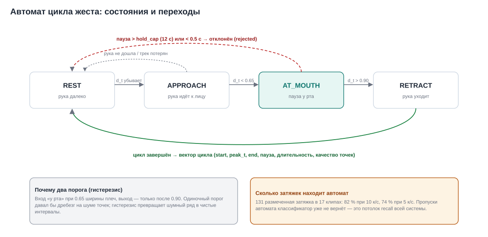

*D3. Состояния REST → APPROACH → AT_MOUTH → RETRACT. Пауза у рта вне диапазона отклоняется. Автомат задаёт потолок recall всей системы: что он пропустил, классификатор уже не вернёт.*

**Почему недостаточно одной позы.** Жест «рука у рта» делают и курильщик, и тот, кто пьёт, говорит по телефону, ест, трёт лицо. По меткам жестов (`docs/review/gesture_gt.csv`) из 505 окон только 131 — затяжки; есть ещё 84 касания лица, 28 питья, 18 телефонов. Поэтому у каждого цикла считаются признаки «что в руке»:
- детектор сигареты на кропе рта 320 px (Beehzod YOLO11m);
- zero-shot CLIP «курение против питья и телефона».

Лучший набор признаков `obj_hold_zsd` — предмет, пауза, длительность, CLIP. Его out-of-fold AUC цикла 0.87 [0.78–0.94]; кинематика одна даёт 0.65 (`docs/MVP.md`).

### 1.4. Конвейер целиком


*D2. Профиль `mvp`: десять этапов и стоимость каждого. Узкие места: частота кадров (74 % затяжек при 5 к/с против 82 % при 10 к/с) и признаки предмета на цикл (1.8 с + 0.7 с на цикл).*

**Что не помогло** (честная таблица из `docs/MVP.md`, `docs/FINAL.md`):

| идея | результат | вывод |
|---|---|---|
| Тяжёлая поза (s/m/x) на полном размере | затяжек не больше, чем n960 + RTMPose-s (15–16 из 16) | размер модели не важен, важен размер входа для дальних людей |
| VLM (Qwen3.5-2B) как признак | +0.03 F1, внутри шума; ≈ 11 с на цикл | только как опциональный арбитр серой зоны |
| Фото-классификатор, обученный на открытых фото | AUC 0.96–0.998 на фото, 0.54–0.65 на кропах камер | перенос домена не работает, нужны кропы со своих камер |
| Дым как признак | AUC 0.48–0.64 | отказ |
| HMDB51 как дополнительные данные | AUC клипа 0.51, рука у рта только в 13 % клипов | крупные планы вне режима камер |
| Интерполяция ряда до 10 Гц при 5 к/с | цикловую долю не вернула | потеря от частоты фундаментальна |

### 1.5. Дальние камеры — главный технический риск

Лестница вычислений (`sd ladder`, имитация дальней камеры с серыми полями):

| рост человека в кадре | n960 | n1280 | n1600 |
|---|---|---|---|
| ≈ 130 px | 7/16 затяжек | 14/16 | 15/16 |
| ≈ 90 px | 2–4/16 при любой настройке | | |

Медиана роста людей в имеющихся клипах — 377 px, а скрытый набор и реальные уличные камеры ожидаются на 80–200 px. Значит:
1. Для дальних камер нужен вход 1280–1600 и/или тайлинг (не реализован) — это ×1.6 и больше по вычислениям.
2. Ниже ≈ 100 px поза ненадёжна. Продукт должен честно помечать такие зоны камеры как «вне гарантии»: ROI и минимальный рост задаются в настройках камеры.

---

## 2. Аудит текущего состояния

### 2.1. Инвентаризация

| область | модули | назначение | судьба в целевой архитектуре |
|---|---|---|---|
| Конвейер | `pipeline.py`, `stages.py`, `pose_track.py`, `features.py`, `cycles.py`, `events.py` | этапы, кэш по хэшам | → `sd.engine` за единым `Stage` API; кэш → хранилище артефактов |
| Признаки цикла | `dataset.py`, `pose_feats.py`, `evidence.py`, `photo_*`, `vlm.py`, `enrich.py`, `pool_features.py` | кинематика, предмет, CLIP, VLM | → плагины сигналов; `enrich` → рецепт FeatureTable |
| Классификатор | `bundle.py`, `cycle_models.py`, `classifier.py`, `train.py` | три стека обучения | → один `sd.services.training`; `train.py` (joblib, pickle) удалить |
| Оценка | `evaluate.py`, `evaluation.py`, `oof_eval.py`, `sweep.py`, `experiments.py`, `runner.py` | Event F1, bootstrap, oof, журнал | → `sd.core.metrics` + `sd.services.evaluation` + PDF |
| Метки | `gt.py`, `gt_pool.py`, `labels_from_gt.py`, `docs/review/*.csv` | события, жесты, циклы | → LabelStore с версиями; CSV — только экспорт |
| Профили и выпуск | `config.py`, `profiles.py`, `solver.py`, `models.py`, `model_tools.py` | конфигурации, решатель, реестр весов | → pydantic-схема, реестр, подписанный выпуск |
| Реальное время | `realtime/engine.py`, `worker.py`, `sources.py`, `store.py`, `replay.py` | поток, тревоги, SQLite | → Inference/ingest-воркеры, EventStore |
| Интерфейсы | `ui/*` (Streamlit, 9 страниц), `web/*` (stdlib HTTP + vanilla JS), `cli.py` | разработчик, оператор, CLI | → Dev Studio, SPA на FastAPI, тонкий CLI |
| Фоновые задачи | `tasks.py` | белый список `sd …`, процессы | → очередь `jobs` в БД с исполнителем |

### 2.2. Сильные стороны (сохранить)

- **Пакеты моделей без pickle** (`bundle.py`: `manifest.json`, `lgbm_*.txt`, `members.json`): безопасная загрузка, переносимость.
- **Отпечатки конфигураций.** `Profile.fingerprint()` учитывает конфигурацию и sha256 весов и пакетов; кэш этапов в `outputs/runs/` уже строится по хэшам параметров.
- **Честная методология.** Out-of-fold по видео, вложенный подбор порога, bootstrap-интервалы по клипам, бюджет ошибок, классификация причин ошибок (`evaluation.classify_errors`).
- **Один код для трёх режимов.** Offline, replay и поток вызывают одни и те же функции признаков, циклов и событий (`StreamEngine` пересчитывает offline-логику на буфере).
- **Решатель как единица выпуска.** `.sdsolver.zip` с проверкой sha256 и разрешёнными режимами; проверка устройства до запуска (`solver.check(devices=True)`).
- **Видео в браузере.** Формат выбирает клиент (H.264 или VP9), перекодирование кэшируется.

### 2.3. Найденные проблемы

**Архитектура и код**

| # | проблема | где | последствие |
|---|---|---|---|
| A1 | CLI на 1769 строк, логика команд дублируется | `src/sd/cli.py` | сложно сопровождать и тестировать |
| A2 | Три стека обучения и два словаря имён признаков | `train.py`, `cycle_models.py` + `bundle.py`, `classifier.py`; `dataset.FEATURE_GROUPS` и `cycle_models.SETS` | расхождения, модель обучена «не на тех» признаках |
| A3 | Набор для обучения — «последний прогон» `recognize` | `oof_eval.collect` берёт лексикографически последний каталог | невоспроизводимость: результат зависит от того, что запускали последним |
| A4 | `recognize` создаёт новый каталог на каждый запуск (у одного клипа уже 13) | `outputs/recognize/` | рост диска, путаница |
| A5 | Дублирование хелперов: sha каталога ×3+, bootstrap AUC ×3, `KEY = ["video","tid","start"]` ×11 | разные модули | ошибки при правке в одном месте |
| A6 | Жёсткие пути в обход `SD_*` | `cli.py` (`ROOT/"models"/"cycle"`), `classifier.py:28`, метки в `docs/review/` | ломается перенос и Docker-тома |
| A7 | Конфигурация — dict с проверкой ключей через `KeyError` | `config.py` | нет типов и подсказок, ошибки во время выполнения |
| A8 | Тяжёлые операции в потоке Streamlit под `st.spinner` | страницы «Оценка», «Анализ», «Классификатор» | закрыли вкладку — работа потеряна, сессия заблокирована |
| A9 | Справка `recognize` обещает эвристику без пакета, а код бросает `ClassifierRequired` | `cli.py:1017` (опция `--cycle-bundle`), `pipeline.py:130` | вводит пользователя в заблуждение |
| A10 | `task.json` пишут два процесса без блокировки | `tasks.py:143,150` | гонка, потеря статуса задачи |

**Безопасность** (веб-приложение `sd app`)

| # | проблема | где | последствие |
|---|---|---|---|
| S1 | Нет входа, ролей и сессий; имя оператора — свободный текст | `web/static/index.html:31` | кто угодно подтверждает и опровергает от чужого имени |
| S2 | Нет проверки Origin/Host и CSRF; тело POST разбирается как JSON при любом Content-Type | `web/server.py:222` | любая открытая в браузере оператора страница может запускать задачи, удалять профили, ставить решатели на `127.0.0.1:8502` (CSRF, DNS rebinding) |
| S3 | `GET /api/profile/<name>` и `/export/profile/<name>.yaml` вызывают `PR.load(name)` без `_check_name`; имя с суффиксом `.yaml` трактуется как путь | `web/admin.py:43,67`, `profiles.py:175` | чтение произвольного YAML на диске |
| S4 | При запуске на `0.0.0.0` (Docker) выключена только загрузка файлов; сохранение и удаление профилей, установка решателя и моделей, запуск задач остаются открытыми | `web/api.py` | удалённое изменение конфигурации |
| S5 | Leaflet и тайлы карты грузятся с внешних CDN | `web/static/map.js:11,74` | противоречит требованию локальности, утечка факта работы |
| S6 | Решатель `.sdsolver.zip` не подписан | `solver.py` | подмена модели при передаче |

**Масштаб и надёжность**

| # | проблема | последствие |
|---|---|---|
| R1 | Задачи анализа в памяти процесса; `Job.frames` растёт без предела, задачи не вытесняются | потеря при перезапуске, рост памяти |
| R2 | Один поток анализа; потоки перекодирования без ограничения | очередь и перегрузка CPU |
| R3 | Монитор обходит камеры последовательно в одном процессе; `CaptureSource` (RTSP) не подключён | нет настоящего «живого» режима |
| R4 | UI опрашивает сервер раз в 5 с, push-уведомлений нет | задержка реакции оператора |
| R5 | `/media/export` читает файл целиком в память | падение на больших видео |
| R6 | В потоке без исходного файла не считаются признаки предмета и фото | в живом режиме годится только быстрый классификатор |
| R7 | Нет онлайн-склейки треков | смена ID делит эпизод на 1 TP + 1 FP |

**Продукт**

| # | чего нет |
|---|---|
| P1 | Города как сущности (район берётся из имени папки, координаты и улицы подставляются заглушкой `geo.py`) |
| P2 | Истории решений: `AlertStore.review()` перезаписывает статус, оператора и заметку |
| P3 | Причин опровержения из справочника, SLA реакции, эскалации, инцидентов |
| P4 | Разбора смен, отчётов (PDF), уведомлений (звук, ОС, webhook) |
| P5 | Демо-режима для заказчика (есть только 14 синтетических тревог `sd monitor-demo`) и десктоп-приложения |
| P6 | Автоматической передачи решений оператора в разметку (есть ручной `sd feedback-export`) |

**Данные и качество**

| # | проблема | последствие |
|---|---|---|
| Q1 | Все метки — одного разметчика (ассистента), согласованность не измерена | систематическая ошибка эталона не видна |
| Q2 | 23 эпизода в 9 клипах; на диске 99 строк `events_gt.csv` (25 POSITIVE, 11 NEGATIVE, 63 IGNORE в 32 клипах); 12 из 19 «курительных» клипов целиком IGNORE | широкие интервалы, оценка завышена |
| Q3 | Классификатор обучен на тех же клипах, на которых считается F1 | оптимизм ≈ 0.05–0.08 F1 (0.83 против вложенной 0.74–0.76) |
| Q4 | Нет дальних ракурсов 80–200 px | главный неизмеренный риск |
| Q5 | Слабые метки папок неверны: `smoking_noyabrsk_2/3` лежат в «лжекурении», но там курят | ошибки в клиповой оценке |
| Q6 | `data/custom` (7 новых клипов) не размечен и не описан | неиспользованные данные |
| Q7 | Значим по сути один признак — `obj_any_max_conf`; разрыв train−oof 0.07, у LightGBM 0.13 | хрупкость к новому детектору и ракурсу |

**Сборка и документация**

- Docker-образ ни разу не собирался; профиль GPU (`laptop_gpu4`) не измерен; оценка `laptop_cpu` недействительна, потому что совпала с порчей эталона.
- `.claude/launch.json` содержит конфигурацию `operator-app`, указывающую на удалённый `src/sd/ui/user_app.py`.
- В документах разное число тестов (195 / 237 / 283 / 316 / 391); сейчас в `tests/` 380 тестовых функций. `ARCHITECTURE.md` §3–4 описывает архивные профили.

**Окружение разработки.** На машине разработки ранее нашли вредоносный майнер (`docs/STATE.md` §5); процессы остановлены, но удаление не подтверждено. Сборку выпусков для заказчика делать только в чистой среде (раздел 9).

---

## 3. Анализ требований

### 3.1. Действующие лица

| роль | цель | где работает |
|---|---|---|
| ML-инженер / исследователь | улучшать распознавание, доказывать качество цифрами | Dev Studio, CLI |
| Разметчик | быстро и согласованно размечать события и жесты | Dev Studio → «Разметка» |
| Оператор смены | быстро и правильно решать по каждому событию | веб или десктоп: очередь, карточка |
| Старший смены | разбирать спорные случаи, контролировать SLA и качество работы смены | очередь «Не уверен», «Разбор» |
| Администратор | города, камеры, пользователи, решатели, хранение | «Администрирование» |
| Заказчик и пресейл | увидеть ценность за 5–10 минут | режим «Демо» |
| Интегратор | получать события в свои системы | REST, webhook, MQTT |

### 3.2. Функциональные требования

**Режим разработчика (D):**

| id | требование | приоритет |
|---|---|---|
| D1 | Валидация выбранной конфигурации (профиль или решатель + переопределения) на выбранных папках с размеченными видео; роль validation или hidden; политика порога: фиксированный, плато, вложенный | must |
| D2 | PDF-отчёт прогона: конфигурация и отпечатки, данные, метрики с CI, кривая порога, ошибки по причинам, таблица по клипам, производительность по этапам, железо, сравнение с эталонным прогоном | must |
| D3 | Анализ всех видео по кэшу: матрица «клип × метрика», автоматический поиск слабых мест, переход к кадру и трассе | must |
| D4 | Разметка видео (события, жесты, циклы) с записью в версионированный набор меток и кэш | must |
| D5 | Построение признаков с гибкой настройкой (генераторы, детекторы, CLIP, VLM, параметры кропов) → именованная таблица признаков | must |
| D6 | Обучение классификаторов на выбранных наборах признаков и данных, сохранение всех моделей в реестре, сравнение и диагностика переобучения | must |
| D7 | Очередь фоновых задач: прогресс, отмена, журнал; работа не теряется при закрытии вкладки | must |
| D8 | Каталог данных: качество видео, рост людей, конфликты слабых меток, дубликаты | should |
| D9 | Профилирование: лестница вычислений, скорость по этапам, железо | should |
| D10 | Выпуск: заморозка, подписанный решатель, манифест | must |
| D11 | Очередь обратной связи: решения оператора → кандидаты в разметку | should |
| D12 | Согласованность разметчиков (κ, F1 между разметчиками) | should |

**Продукт оператора (O):**

| id | требование | приоритет |
|---|---|---|
| O1 | Выбор города; иерархия город → район → объект (улица) → камера | must |
| O2 | Накопление событий по городам с состояниями «новое / на рассмотрении / подтверждено / ложное / не уверен / эскалировано / закрыто» | must |
| O3 | Карточка события: клип с рамкой и скелетом, ключевые кадры, объяснение «почему сработало», решение одной клавишей, причина опровержения из справочника, заметка | must |
| O4 | Очередь с приоритетом и SLA реакции, автопереход к следующему событию | must |
| O5 | Разбор: ретроспектива по периоду, району, камере, оператору; доля ложных; причины; время реакции; экспорт PDF и CSV | must |
| O6 | Вход, роли, журнал аудита, неизменяемая история решений | must |
| O7 | Уведомления: в интерфейсе, звук, уведомление ОС (десктоп), webhook | should |
| O8 | Здоровье камер: онлайн или нет, задержка, последний кадр, ROI и минимальный рост | should |
| O9 | Демо для заказчика: имитация платформы по локальным папкам, режим ведущего, маскирование лиц | must |
| O10 | Два вида поставки: веб и десктоп, из одного кода | must |
| O11 | Живой просмотр камеры (HLS/WebRTC) | could |
| O12 | Инциденты: группировка событий, назначение, эскалация | could |

### 3.3. Нефункциональные требования

| id | требование | метрика приёмки |
|---|---|---|
| N1 | Локальность: видео не покидает контур заказчика; работа без интернета | `--network none` проходит смоук-тест; нет внешних URL в SPA |
| N2 | Реальное время | rt_factor ≥ 1.0 на целевом железе для N камер; тревога ≤ 15 с после второго цикла |
| N3 | Качество | Event F1 на holdout с CI; FP в час ≤ согласованного (напр. ≤ 1 на камеру в смену) |
| N4 | Воспроизводимость | любой прогон и отчёт восстанавливается по отпечаткам (видео, метки, решатель, код) |
| N5 | Аудит | любое действие пользователя в журнале; решения неизменяемы |
| N6 | Приватность (152-ФЗ) | сроки хранения, маскирование, доступ по ролям, локальная обработка |
| N7 | Лицензионная чистота | все веса и данные выпуска с коммерческой лицензией (раздел 9) |
| N8 | Переносимость | Windows 10/11 (десктоп), Linux + Docker (сервер); CPU, iGPU (OpenVINO), NVIDIA (CUDA) |
| N9 | Отзывчивость интерфейса | действие оператора → отклик < 200 мс; новое событие на экране < 2 с после записи |
| N10 | Сопровождаемость | модули < 600 строк, типизированная конфигурация, CI с тестами и линтером |

### 3.4. Трассировка: требование → компонент → экран

| требование | сервис / компонент | экран | проверка |
|---|---|---|---|
| D1, D2 | `services.evaluation`, `services.reports` | Dev Studio → Валидация (W1) | PDF воспроизводит числа `report.json` |
| D3 | DuckDB поверх артефактов, `services.analysis` | Валидация → Анализ кэша (W2) | клик по слабому месту открывает кадр |
| D4, D12 | `data.labels` (LabelStore) | Задачи → Разметка | версия набора меток растёт, κ считается |
| D5 | `services.features` (рецепт → FeatureTable) | Задачи → Признаки | повтор рецепта даёт тот же sha |
| D6 | `services.training`, `data.registry` | Задачи → Обучение (W3) | пакет в реестре с диагностикой |
| D7 | `services.jobs` + исполнитель | все вкладки, «Очередь задач» | закрыли вкладку → задача продолжается |
| D10 | `services.release` | Выпуск | решатель подписан, манифест с отпечатками |
| O1, O2, O8 | `services.events`, `data.events` | Обзор города (W4), Камеры | события накапливаются по городу |
| O3, O4 | `services.events` + SSE | Очередь + карточка (W5) | решение ≤ 2 действия, SLA видно |
| O5 | `services.reports` | Разбор (W6), Отчёты | PDF за период |
| O6 | `services.auth`, `data.audit` | Вход, Администрирование | действия в журнале |
| O9 | `services.demo` | Демо (W7) | показ без сети и без GPU |
| O10 | SPA + pywebview | W8 | один и тот же SPA в обоих видах |

---

## 4. Целевая архитектура

### 4.1. Принцип: одно ядро, два режима

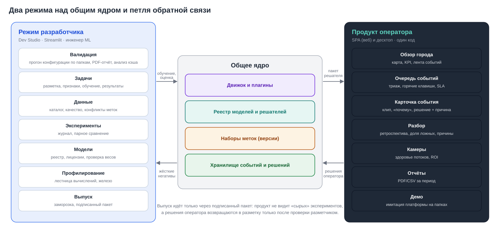

*D5. Dev Studio и продукт оператора — два разных интерфейса над одним ядром. Обмен идёт по двум каналам: подписанный пакет решателя (разработка → эксплуатация) и решения оператора (эксплуатация → разметка, после проверки разметчиком).*

Почему так:
- **Разные пользователи, разные темпы.** Инженеру нужна гибкость: любые переопределения, сырые таблицы, эксперименты. Оператору нужна предсказуемость: одна утверждённая конфигурация, понятная карточка, никаких «ручек» модели. Сейчас экраны «Модели и профили», «Передача», «Проверка на данных» живут в приложении оператора. В целевой архитектуре они **переезжают в Dev Studio**, а SPA оператора остаётся чистым.
- **Один движок.** Распознавание в отчёте разработчика и в тревоге оператора должно давать одно и то же. Это уже заложено (`StreamEngine` пересчитывает offline-логику); архитектура это закрепляет.

### 4.2. Слои

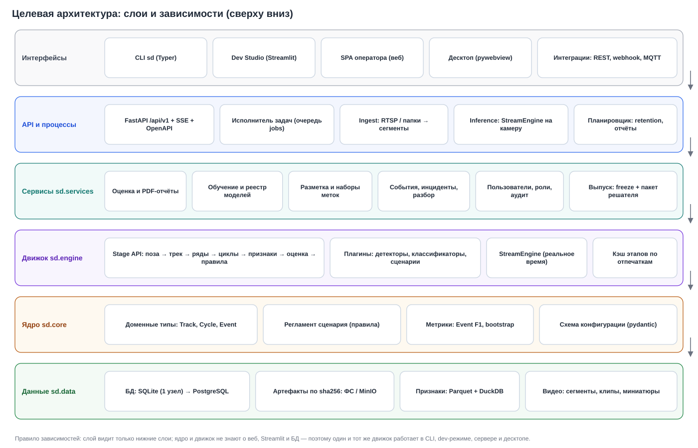

*D4. Слои и зависимости только сверху вниз. Ядро и движок не знают об интерфейсах и БД, поэтому одинаково работают в CLI, Dev Studio, сервере и десктопе.*

| слой | пакет | содержимое | ключевые правила |
|---|---|---|---|
| Ядро | `sd.core` | доменные типы (`Track`, `Cycle`, `Event`, `Decision`), регламент сценария, метрики (Event F1, bootstrap, причины ошибок), схема конфигурации (pydantic) | только чистые функции; без I/O |
| Движок | `sd.engine` | `Stage` API, реестр плагинов (позы, детекторы, классификаторы, сценарии), `StreamEngine`, кэш этапов | этап = чистая функция `(входы, параметры) → артефакт` + ключ кэша |
| Данные | `sd.data` | репозитории: `LabelStore`, `ArtifactStore`, `ModelRegistry`, `EventStore`, `UserStore`, `AuditLog` | SQLAlchemy 2 + Alembic; файлы — через ArtifactStore |
| Сервисы | `sd.services` | jobs, evaluation, reports, features, training, labeling, release, events, demo, auth | сценарии использования; транзакции; проверки прав |
| Адаптеры | `sd.cli`, `sd.devstudio`, `sd.api`, `sd.workers`, `sd.desktop` | Typer, Streamlit, FastAPI, ingest и inference, pywebview | тонкие: только разбор ввода и вызов сервиса |

### 4.3. Движок: контракт этапа и плагины

```python
class Stage(Protocol):
    name: str                       # "pose", "series", "cycles", "evidence", "score", "events"
    version: str                    # меняется при изменении логики → новый ключ кэша
    inputs: tuple[str, ...]         # имена артефактов-входов
    params_model: type[BaseModel]   # pydantic-схема параметров этапа
    def key(self, input_keys: dict[str, str], params: BaseModel) -> str: ...
    def run(self, inputs: dict[str, Artifact], params: BaseModel, ctx: RunContext) -> Artifact: ...
```

- **Плагины семейств** регистрируются через entry points (`sd.plugins.pose`, `sd.plugins.detector`, `sd.plugins.classifier`, `sd.plugins.scenario`). Новая модель позы или детектор добавляется без правки ядра (пункт P2-6 из `AUDIT_AND_CHANGES.md`).
- **RunContext** даёт устройство (CPU, OpenVINO iGPU, CUDA), лимиты памяти, прогресс и отмену. Через него задачи сообщают прогресс в очередь.
- **Инференс без torch в продукте.** Позу и детекторы экспортировать в OpenVINO IR или ONNX (RTMPose уже идёт через onnxruntime). Torch остаётся только в Dev Studio для обучения и экспорта. Десктоп-сборка становится в разы меньше, а зависимость от AGPL-кода Ultralytics в рантайме исчезает (раздел 9).

### 4.4. Реальное время

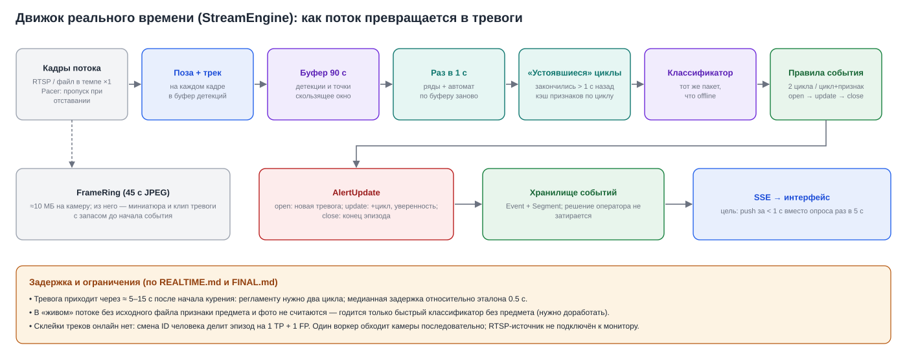

*D11. Как поток превращается в тревоги. Буфер 90 с пересчитывается раз в секунду; считаются только «устоявшиеся» циклы; тревога проходит состояния open → update → close.*

Что доработать для продукта:
1. **Процесс на группу камер.** Ingest-воркер (RTSP → сегменты на диск + кадры в inference) и inference-воркер со `StreamEngine` на камеру. Ограничение параллелизма по устройству. Батчинг позы для нескольких камер на GPU.
2. **Признаки предмета в потоке.** Кропы рта брать из `FrameRing` (кадры уже в памяти), а не из исходного файла. Это снимает ограничение R6, и в живом режиме работает полный классификатор `cycle_mvp`.
3. **Онлайн-склейка треков** по близости рамок и позы за 2–3 с (аналог offline `stitch_tracks`), чтобы смена ID не делила эпизод.
4. **SSE вместо опроса.** `EventStore` публикует изменения; FastAPI отдаёт `text/event-stream`; задержка до экрана < 1 с.
5. **Сохранение контекста при перезапуске.** Сейчас обработанные фрагменты помнятся, а буфер жестов теряется. Минимум — дописывать последние 90 с детекций в артефакт сегмента.

### 4.5. Очередь задач (общая для Dev Studio и оператора)

Таблица `jobs` в той же БД:

| поле | смысл |
|---|---|
| `id`, `kind` | вид задачи: eval, train, features, report, transcode, demo-precompute, … |
| `params` | JSON, проверенный pydantic-схемой вида задачи |
| `status` | queued, running, done, failed, cancelled |
| `progress`, `message` | 0..1 и строка состояния |
| `owner`, `created`, `started`, `finished` | кто и когда |
| `result_ref` | ключ артефакта результата |
| `log_path` | журнал задачи |

Исполнитель — отдельный процесс (или несколько, по ресурсу: `cpu`, `gpu`). Задачу он забирает атомарно:
- SQLite: `UPDATE … WHERE status='queued' … RETURNING`;
- PostgreSQL: `SELECT … FOR UPDATE SKIP LOCKED`.

Для одного узла Redis и брокер не нужны. Отмена — флаг в строке, который `RunContext` проверяет между клипами. Белый список видов задач сохраняется (как `tasks.CATALOG`), но аргументы — типизированные модели, а не argv.

### 4.6. Карта миграции

| сейчас | цель | комментарий |
|---|---|---|
| `cli.py` (1769 строк) | `sd/cli/{run,eval,data,train,release,ops}.py` | команды вызывают сервисы; тела по 5–20 строк |
| `train.py`, `cycle_models.py`, `classifier.py`, `bundle.py` | `services/training.py` + `engine/classifiers/ensemble.py` | один словарь признаков; joblib удалить |
| `oof_eval.py`, `evaluation.py`, `evaluate.py`, `sweep.py` | `core/metrics.py` + `services/evaluation.py` | метрики чистые, сервис пишет EvalRun |
| `enrich.py`, `pool_features.py`, `feature_auc.py` | `services/features.py` (рецепты) | FeatureTable с манифестом вместо «последнего прогона» |
| `gt.py`, `gt_pool.py`, `labels_from_gt.py`, `docs/review/*.csv` | `data/labels.py` (LabelStore) | CSV — импорт и экспорт; метки уходят из `docs/` |
| `profiles.py`, `config.py`, `solver.py` | `core/config.py` (pydantic) + `services/release.py` | подпись решателя, схема версий |
| `realtime/*` | `engine/stream.py` + `workers/{ingest,inference}.py` + `data/events.py` | Review — append-only |
| `web/server.py`, `web/api.py`, `web/admin.py`, `web/tuning.py` | `api/` (FastAPI routers: auth, cities, cameras, events, reviews, reports, media, demo) | экраны настройки моделей → Dev Studio |
| `ui/*` (9 страниц) | `devstudio/` (7 вкладок, раздел 6) | тяжёлое — через jobs |
| `tasks.py` | `services/jobs.py` + `workers/executor.py` | БД вместо `task.json` |

---

## 5. Данные: как хранить и обрабатывать

### 5.1. Три вида данных — три способа хранения

| вид | примеры | свойства | где хранить |
|---|---|---|---|
| **Сырые медиа** | исходные видео датасетов, сегменты камер, клипы событий, миниатюры | большие, неизменяемые | файловая система или S3-совместимое хранилище (MinIO); адресация по sha256; метаданные в БД |
| **Производные артефакты** | позы, ряды, циклы, обогащение, таблицы признаков, модели, отчёты | детерминированы входами и параметрами, пересчитываемы | ArtifactStore: `artifacts/<этап>/<ключ>/` (Parquet, npy, JSON) + запись `StageRun` в БД |
| **Записи и решения** | метки, события, решения операторов, пользователи, аудит, задачи | маленькие, изменяемые по правилам, требуют транзакций и истории | реляционная БД: SQLite (WAL) на одном узле, PostgreSQL на нескольких; миграции Alembic |

### 5.2. Модель данных

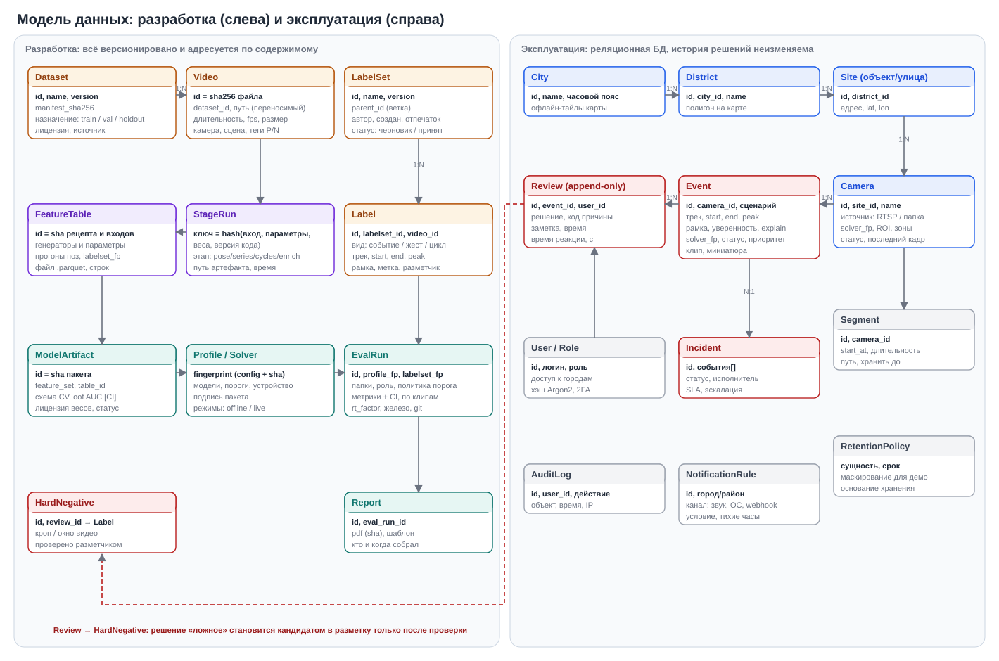

*D6. Слева — разработка: всё версионировано и адресуется по содержимому. Справа — эксплуатация: город → район → объект → камера → события и решения. Связь Review → HardNegative — канал обратной связи, он работает только после проверки разметчиком.*

Ключевые решения:
- **Video.id = sha256 файла.** Переименование или перенос файла не ломает метки и кэш. Путь хранится переносимым (`$DATA/…`, как уже делает `paths.to_portable`).
- **LabelSet с версиями и ветками.** Метки не перезаписываются: правка создаёт новую версию набора, отпечаток которого входит в каждый EvalRun (сейчас — `gt_fingerprint`). Можно сравнить «модель на метках v6 и v7» и доказать, что рост F1 не от правки эталона.
- **Review — только добавление.** Каждое решение — новая строка; текущий статус события — последняя строка (или материализованное поле, которое обновляется триггером). Сейчас `AlertStore.review()` затирает прежнее решение (P2).
- **Event хранит `solver_fp`.** Всегда известно, какая версия модели подняла тревогу. Это нужно для разбора и для обратной связи: жёсткие негативы привязаны к версии.
- **Город, район, объект, камера — сущности, а не части имени папки.** Сегодняшнее соглашение `<район>-<индекс>-<время>` остаётся форматом импорта для демо и офлайн-папок.

### 5.3. Происхождение артефактов и кэш

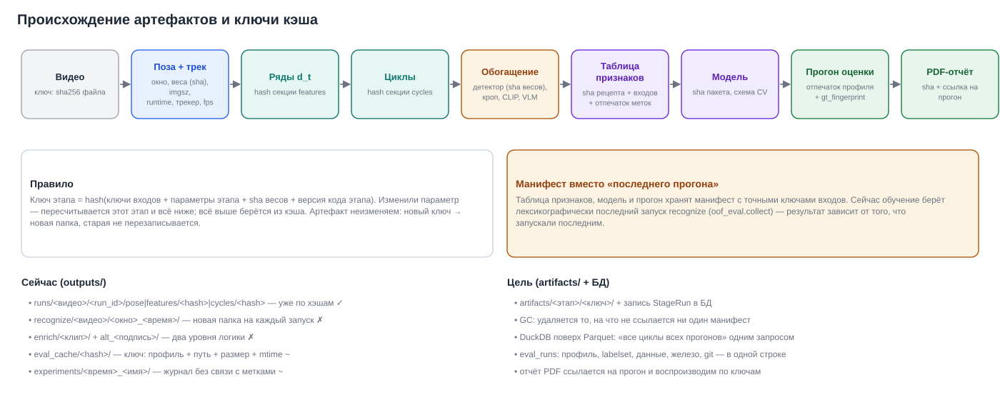

*D7. Ключ каждого этапа — хэш ключей входов, параметров, sha весов и версии кода этапа. Изменение параметра пересчитывает только этот этап и всё ниже.*

Правила:
1. **Артефакт неизменяем.** Новый ключ — новая папка; старая не перезаписывается (сейчас `recognize` плодит каталоги по времени, а `enrich` хранит «первого записавшего» и `alt_<подпись>`).
2. **Манифест вместо «последнего».** Таблица признаков, модель и прогон хранят точные ключи входов. `sd train --table ft_…` обучает на конкретной таблице, а не на том, что запускали последним (A3).
3. **Сборка мусора** удаляет артефакты, на которые не ссылается ни один манифест, EvalRun, решатель или закреплённый (pinned) эксперимент. Политика — в настройках (например, 30 дней для незакреплённых).
4. **Аналитика кэша через DuckDB.** Представления поверх Parquet всех прогонов: «все циклы с оценками и метками по всем видео» — один SQL-запрос, без загрузки в память. Это основа вкладки «Анализ кэша» (W2).

### 5.4. Набор данных: структура и манифест

```
datasets/
  gatchina_cctv_v1/
    manifest.yaml        # id, версия, лицензия/основание, источник, описание, разбиение
    videos.parquet       # video_id(sha256), путь, длительность, fps, размер, камера, сцена, теги, split
    media/…              # сами файлы (или ссылка на MinIO/NAS)
  external/…             # открытые наборы — отдельно, с лицензиями; в выпуск не попадают
labels (в БД):  labelsets(id, name, version, parent, author, status) · labels(...)
```

- **Разбиение по группам.** Группа = камера + актёр + дубль; видео одной группы не попадают в разные части. Holdout фиксируется хэшем списка видео и **никогда** не используется для подбора; роль `hidden` в оценке уже запрещает подбор порога.
- **Теги сценариев** P01–P08 (позитивы: стоя, сидя, в группе, ночь ИК, дальний план, сигарета не видна, вейп, со спины) и N01–N08 (негативы: питьё, телефон, еда, касание лица, ручка, разговор с жестами, поправляет маску, курение вне кадра). Метрики считаются по тегам, и видно, *где* модель слаба, а не только «насколько» (P1-4 аудита).
- **Слабые метки папок** — только как подсказка. Конфликт «папка говорит лжекурение, а эталон содержит POSITIVE» (случай `noyabrsk_2/3`) показывается во вкладке «Данные».
- **Внешние данные** (`data_external/`, 6209 файлов, в том числе Stanford40 и HMDB51) убрать из git (P1-5). Держать отдельно с полем лицензии и **не** включать в коммерческие выпуски.

### 5.5. Видео в эксплуатации

| объект | формат | срок хранения (пример) | основание |
|---|---|---|---|
| Сегменты камеры (оригинал) | MP4/MKV, как с камеры, сегменты 1–5 мин | 3–7 дней кольцом | разбор, перерасчёт |
| Клип события | H.264 MP4, −10…+10 с вокруг эпизода, faststart | 30–90 дней; подтверждённые — по регламенту заказчика | доказательство, обучение |
| Миниатюры и ключевые кадры | JPEG | как у клипа | карточка, отчёты |
| Трасса события (`trace.json`) | JSON: треки, точки, циклы, оценки | как у клипа | «почему сработало», отладка |
| Кропы жёстких негативов | JPEG + JSON | до включения в датасет | обучение |

Сроки — настройка `RetentionPolicy`; удаление выполняет планировщик, и каждое удаление попадает в аудит. Демо и выгрузки по умолчанию маскируют лица (размытие головы по точкам позы — точки уже есть).

### 5.6. Что добавить к данным в первую очередь

1. **Второй разметчик** на 30–50 % клипов и метрика согласия: F1 между разметчиками по тому же протоколу и κ по жестам. Без этого любое «улучшение на 0.02» неотличимо от шума эталона.
2. **Дальние ракурсы** 80–200 px: съёмка или открытые видео с людьми целиком; плюс синтетика zoom-out с серыми полями (уже есть `scaled_copy(pad=True)`).
3. **Жёсткие негативы** из решений оператора (питьё, телефон, касание лица) с проверкой разметчиком.
4. **Разметка `data/custom`** (7 клипов) и исправление слабых меток папок.

---

## 6. Режим разработчика (Dev Studio)

Dev Studio — Streamlit-приложение для инженера, которое проверяет архитектуру и модель. Здесь всё можно настроить, и всё сохраняется с отпечатками. Нынешние 9 страниц сводятся в 7 вкладок верхнего уровня:

| вкладка | что внутри | откуда берётся сейчас |
|---|---|---|
| **Валидация** | Запуск и отчёт · Анализ кэша · Сравнение прогонов | «Оценка», «Журнал», «Просмотр», «Реальное время» |
| **Задачи** | Разметка · Признаки · Обучение · Результаты · Очередь задач | «Разметка», «Анализ», «Классификатор», «Задачи» |
| **Данные** | каталог, качество, теги, разбиение, конфликты меток | новое (`library.py`, `eda.py`) |
| **Эксперименты** | журнал, закрепление, парный bootstrap, варианты профиля | «Журнал» |
| **Модели** | реестр весов и пакетов, лицензии, проверка `.pt`, экспорт OpenVINO/ONNX | «Модели», веб «Модели и профили» |
| **Профилирование** | лестница вычислений, скорость по этапам, профиль железа | `sd ladder`, `sd bench`, `sd resources` |
| **Выпуск** | заморозка, подпись решателя, манифест, ворота качества | веб «Передача», `sd solver` |

**Технические правила Dev Studio:**
- **Всё тяжёлое идёт через очередь задач** (раздел 4.5). Страница ставит задачу и показывает прогресс фрагментом `@st.fragment(run_every=2)`. Закрытие вкладки работу не прерывает (A8).
- **Чтение данных** — через `@st.cache_data` по ключу артефакта: ключ неизменяем, поэтому кэш никогда не устаревает.
- **`st.session_state`** хранит только состояние интерфейса (выбранный прогон, фильтры), но не данные.
- **Плеер с трассой** — один компонент на базе существующих `ui/player.py` и `ui/frontend/labeler`. Видео подаётся файлом через медиа-менеджер, без base64: в `ui/media.py` это уже исправлено.

### 6.1. Валидация

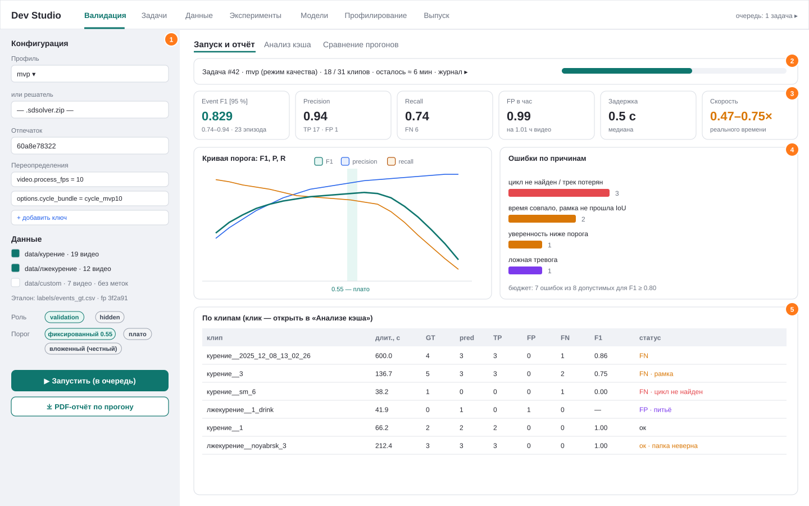

*W1. Зоны: ① конфигурация и данные; ② задача в очереди с прогрессом; ③ ключевые метрики с доверительным интервалом и скоростью; ④ кривая порога с плато и ошибки по причинам с бюджетом; ⑤ таблица клипов со статусом и переходом в анализ.*

**Входы:**
- профиль из `configs/experiments` или решатель `.sdsolver.zip`;
- переопределения `ключ = значение` (с подсказками из pydantic-схемы);
- папки (из каталога данных) и набор меток (версия LabelSet);
- роль: `validation` или `hidden`;
- политика порога: фиксированный, плато, вложенный.

**Что делает задача.** Вызывает `services.evaluation.run(...)`: по каждому клипу движок с кэшем этапов, затем метрики, bootstrap, причины ошибок и бюджет. Результат пишется в EvalRun с отпечатками профиля, меток, данных, кода и железа.

**PDF-отчёт прогона** (`services.reports.eval_pdf`):

| раздел | содержимое | источник данных |
|---|---|---|
| Титул | название, дата, автор, отпечаток прогона, статус «validation / hidden» | EvalRun |
| 1. Конфигурация | профиль (описание + все отличия от `default.yaml`), решатель, классификатор, веса (sha256 и лицензии) | Profile, ModelRegistry |
| 2. Данные | папки, число клипов и часов, набор меток и версия, число эпизодов POSITIVE / NEGATIVE / IGNORE, распределение роста людей | LabelSet, Video |
| 3. Качество | F1, P, R с 95 % CI; FP в час (все клипы и только негативные); медианная задержка; бюджет ошибок | `report.json` |
| 4. Порог | кривая F1, P и R по порогу, плато, выбранный порог и политика | `curve.csv` |
| 5. Ошибки | таблица причин (`missed`, `wrong_box`, `below_threshold`, FP по типу), примеры с миниатюрами | `errors.csv` + кадры |
| 6. По клипам | таблица; худшие 10 — с полосой времени (эталон и предсказание) | `per_clip.csv` |
| 7. Производительность | rt_factor по клипам; время по этапам (поза, уточнение, ряды, автомат, предмет, CLIP, классификатор); пиковая память; устройство | профайлер RunContext |
| 8. Сравнение | разница с эталонным прогоном (парный bootstrap), какие клипы улучшились и ухудшились | `paired_bootstrap` |
| Приложение | полный YAML профиля, версии пакетов, git-коммит, команда воспроизведения | EvalRun |

**Технология отчёта.** matplotlib (графики в SVG/PNG, уже в зависимостях) и ReportLab (вёрстка PDF, лицензия BSD, без системных библиотек; шрифт с кириллицей, например DejaVu Sans или PT Sans, кладётся в пакет). Тот же генератор строит отчёты оператора (раздел 7.4), чтобы оформление было одинаковым. Альтернатива — HTML-шаблон и печать через Chromium; это даёт гибкую вёрстку, но нужен браузер в рантайме, поэтому как основной путь не выбран.

**Анализ кэша** (W2) отвечает на вопрос «где и почему модель слаба» по **всем** видео и прогонам из кэша:

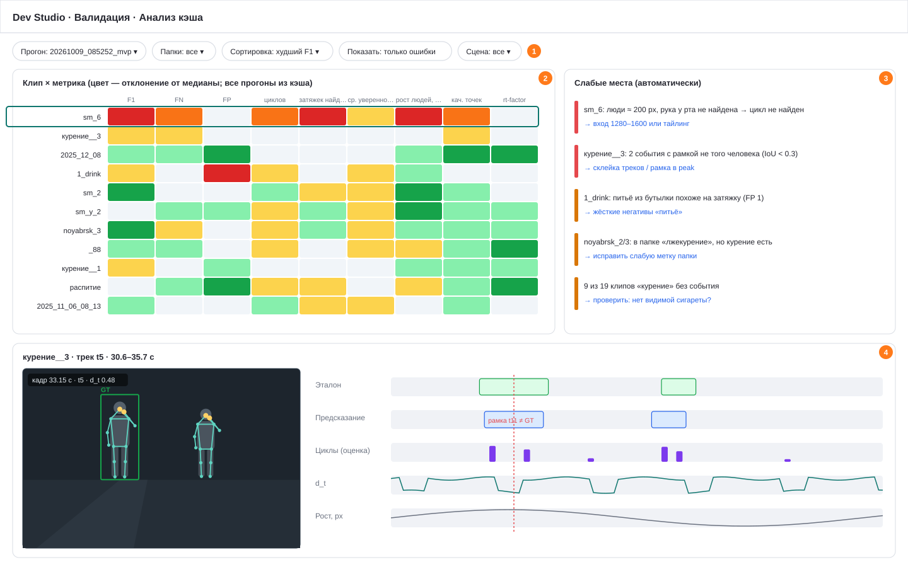

*W2. ① Фильтры прогона, папок, сцены. ② Тепловая карта «клип × метрика»: F1, FN, FP, число циклов, доля найденных затяжек, средняя уверенность, рост людей, качество точек, rt_factor; цвет — отклонение от медианы. ③ Автоматические «слабые места» с рекомендацией. ④ Детализация: кадр со скелетом и рамкой эталона, дорожки «эталон / предсказание / циклы с оценкой / d_t / рост».*

**Правила поиска слабых мест** — детерминированные, их можно проверить:

| правило | условие | рекомендация |
|---|---|---|
| Мелкие люди | медиана роста трека < 150 px и FN | вход 1280–1600 или тайлинг; ROI |
| Цикл не найден | FN, а в окне эталона нет цикла | проверить точки (качество < порога), частоту кадров |
| Чужая рамка | `wrong_box` | склейка треков; рамка в peak |
| Ниже порога | `below_threshold` | признаки предмета (виден ли), калибровка |
| Похожий жест | FP, в метках жеста — питьё, телефон или касание | жёсткие негативы этого типа |
| Конфликт меток | слабая метка папки ≠ эталон | исправить метку или переложить файл |
| Медленно | rt_factor < 1 | 4K, плотная сцена → понизить fps, ROI, iGPU |

Запросы идут через DuckDB по Parquet-артефактам (`cycles`, `events`, `errors`) и по EvalRun в БД.

**Сравнение прогонов.** Два EvalRun рядом: разница F1 с парным bootstrap (`evaluation.paired_bootstrap`), клипы с изменившимся статусом, разные параметры (diff профилей).

### 6.2. Задачи

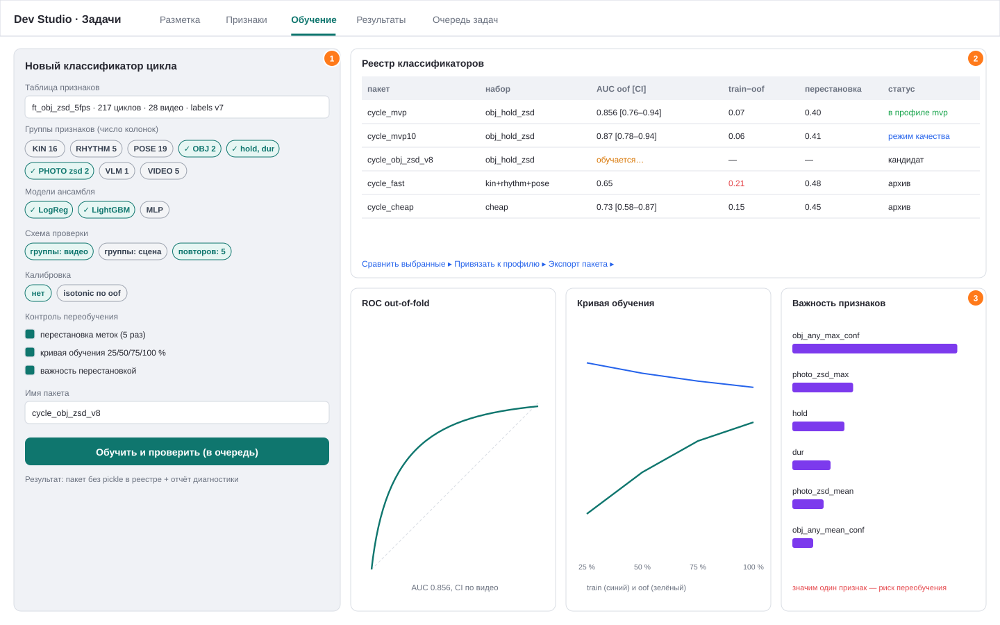

*W3. ① Форма обучения: таблица признаков, группы признаков, модели ансамбля, схема проверки, калибровка, контроль переобучения. ② Реестр классификаторов с oof AUC, разрывом train−oof, контролем перестановкой и статусом. ③ Диагностика: ROC, кривая обучения, важность признаков.*

**Разметка**
- Единый разметчик событий и жестов на основе `ui/frontend/labeler`. Клавиши I/O/P/1/2/3/Enter сохраняются; рамка человека выбирается кликом по треку из кэша поз.
- Каждая правка — новая версия LabelSet: черновик, затем «принять».
- Режимы:
  - **Событие** — эпизод, человек, peak, рамка;
  - **Жест** — затяжка, питьё, телефон, касание, нет жеста, неясно;
  - **Проверка кандидатов** — очередь циклов с наибольшей неопределённостью модели или из решений оператора.
- **Согласованность:** второй разметчик видит те же клипы вслепую; считаются F1 между разметчиками и κ.

**Признаки**
- Рецепт = генераторы циклов (автомат, пул кандидатов) + сигналы (кинематика, ритм, поза, предмет с выбором детекторов, CLIP zero-shot, фото-голова, VLM) + параметры кропов и частоты + источник поз (ключ профиля позы).
- Результат — FeatureTable с манифестом и отчётом: число циклов, доля пропусков, AUC каждого признака с CI по видео (`feature_auc`).
- Повторный запуск того же рецепта берёт артефакт из кэша.

**Обучение**
- Выбор:
  - таблица признаков и набор меток;
  - группы и колонки признаков (наборы `cycle_models.SETS` становятся пресетами);
  - модели ансамбля: LogReg, LightGBM, MLP;
  - схема CV: группы по видео или по сцене, число повторов;
  - калибровка.
- Результат — пакет без pickle в реестре: `manifest.json` с рецептом, метками, oof-предсказаниями и диагностикой.
- Диагностика (уже есть в `classifier.diagnose`): разрыв train−oof, контроль перестановкой меток (AUC ≈ 0.5 — признаков утечки нет), кривая обучения, важность перестановкой.
- **Предупреждения**, которые надо показывать:
  - значим один признак;
  - разрыв > 0.1;
  - < 100 позитивов;
  - признак недоступен в живом режиме.
- Привязка к профилю только через «Выпуск» или явное действие с подтверждением.

**Результаты** — сравнение моделей реестра на одной таблице: AUC с CI, F1 событий через `oof_eval` (вложенный порог), стоимость признаков (секунд на цикл) и пригодность для живого режима.

**Очередь задач** — все задачи пользователя и системы: статус, прогресс, журнал, отмена, повтор с теми же параметрами.

### 6.3. Остальные вкладки

| вкладка | ключевые функции | зачем |
|---|---|---|
| **Данные** | каталог датасетов и видео; гистограммы роста людей, освещённости, fps, разрешения; теги P/N; разбиение train/val/holdout с проверкой групп; конфликты слабых меток; дубликаты по sha | понимать, на чём учимся и проверяемся |
| **Эксперименты** | журнал EvalRun с фильтрами; закрепление; варианты профиля из таблицы (`sweep`); парное сравнение | дисциплина экспериментов |
| **Модели** | реестр весов с лицензией и доверием; проверка `.pt` (`sd models scan`); экспорт в OpenVINO и ONNX с проверкой косинуса; тест модели на кадре | безопасность цепочки поставки, переносимость |
| **Профилирование** | лестница вычислений (`ladder`); скорость по этапам на выбранном железе; профиль железа (`hw`, `resources`); рекомендация fps, imgsz и числа камер | планирование внедрения и честные обещания |
| **Выпуск** | заморозка: решатель (профиль + пакеты + веса) + манифест (отпечатки, EvalRun, holdout, git) + подпись; ворота качества (раздел 10); журнал выпусков | единственный путь модели в продукт |
| **Обратная связь** (внутри «Задач» или отдельно) | очередь решений оператора: ложные с причиной, подтверждённые, неясные; проверка разметчиком → LabelSet; экспорт кропов жёстких негативов | замкнуть петлю качества |

---

## 7. Продукт оператора: веб и десктоп

### 7.1. Персоны и сценарии

| персона | типичный день | что важно |
|---|---|---|
| **Оператор смены** | 12 часов у экрана; получает 10–40 событий; на каждое 15–60 с | не пропустить новое; решить за 1–2 действия; видеть доказательство; не уставать (тёмная тема, без мигания) |
| **Старший смены** | контроль SLA, решения по «не уверен», отчёт за смену | очередь эскалаций, качество работы операторов, выгрузка |
| **Администратор** | камеры, ROI, пользователи, решатели, хранение | безопасные изменения, аудит |
| **Руководитель / заказчик** | раз в неделю смотрит динамику по районам | сводка, PDF, тренды |

Главный сценарий оператора: звук или значок → очередь → карточка открыта автоматически → просмотр клипа (2–10 с) → Y или N + цифра причины → следующее событие открывается само.

### 7.2. Информационная архитектура

```
Город ─┬─ Район ─┬─ Объект / улица ─┬─ Камера ─┬─ Сегменты видео
       │         │                  │          └─ События ─┬─ Решения (история)
       │         │                  │                      └─ Инцидент (опц.)
       └─ Настройки города: часовой пояс, тайлы карты, SLA, уведомления, сроки хранения
```

Пользователь имеет доступ к одному или нескольким городам. Переключатель города стоит в шапке, и все экраны фильтруются по нему.

### 7.3. Жизненный цикл события

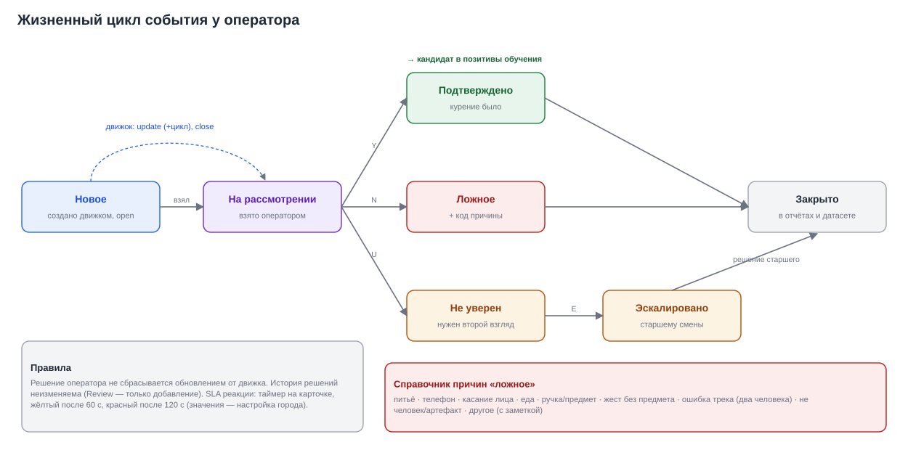

*D8. Состояния события и переходы. Пока событие открыто (open), движок может его обновлять (+цикл, рост уверенности). Решение оператора при этом не сбрасывается. История решений неизменяема.*

- **Приоритет в очереди** = f(уверенность, время ожидания относительно SLA, критичность объекта). Например, вход в учреждение весит больше парка.
- **SLA:** таймер на карточке и в очереди. Пороги задаются на уровне города (пример: жёлтый после 60 с, красный после 120 с).
- **Причины «ложное»** — справочник с цифровыми клавишами: питьё, телефон, касание лица, еда, ручка или предмет, жест без предмета, ошибка трека, не человек, другое. Причина обязательна: это сырьё для жёстких негативов и для разбора камер.
- **Инцидент** — группа событий одного места или времени (например, компания курит у входа). Назначается исполнителю (охрана, патруль) и закрывается с результатом.

### 7.4. Экраны

**Обзор города** — стартовый экран смены.

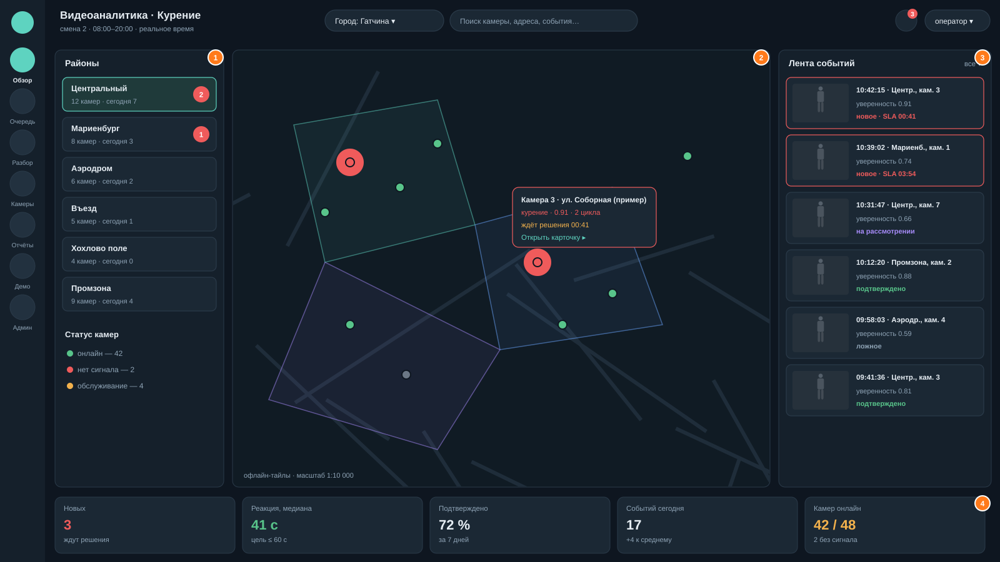

*W4. ① Районы с числом новых событий и состоянием камер. ② Карта (офлайн-тайлы) с полигонами районов; камеры с новыми событиями пульсируют; всплывающая карточка ведёт в событие. ③ Лента событий со статусом и SLA. ④ KPI смены: новые, реакция, доля подтверждённых, события за сегодня, камеры онлайн.*

**Очередь и карточка события** — основной рабочий экран.

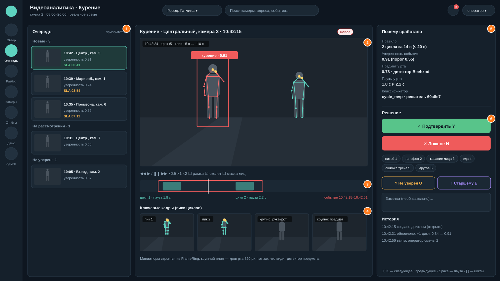

*W5. ① Очередь по приоритету, сгруппированная по статусу, с SLA. ② Клип события с рамкой и скелетом нужного человека; второй человек не выделен. ③ Таймлайн с циклами и границами события. ④ Ключевые кадры: пики циклов и крупный кроп рта — тот же, что видел детектор. ⑤ «Почему сработало»: правило, уверенность, сигнал предмета, паузы, версия решателя. ⑥ Решение: Y / N + причина цифрой / U / E, заметка, история.*

Правила карточки:
1. **Объяснение обязательно.** Оператор должен видеть *основание* тревоги: два цикла, паузы, предмет. Тогда «ложное» с причиной — осмысленное решение, а не угадывание. Данные уже есть: `StreamEngine.cycle_log` и `trace.json` (вкладки «Триггеры / Уверенность / Люди» текущего веба).
2. **Решение — не больше 2 действий:** Y; или N + цифра; или U; или E. После решения 10 с показывается «Отменить» вместо диалога подтверждения, затем автоматически открывается следующее событие.
3. **Клип воспроизводится сам** с −3 с до начала, на ×1. Скорость ×2 включается клавишей; есть пауза и перемотка по циклам `[ ]`.
4. **Маскирование лиц** включается по политике города (по умолчанию выключено для оператора и включено для экспорта и демо).

**Разбор** — ретроспектива для старшего смены и руководителя.

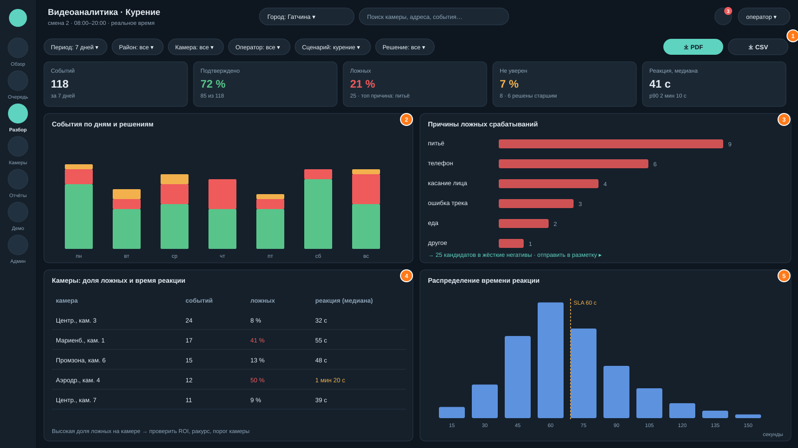

*W6. ① Фильтры (период, район, камера, оператор, сценарий, решение) и экспорт PDF/CSV. ② События по дням и решениям. ③ Причины ложных с переходом «отправить в разметку». ④ Камеры: доля ложных и время реакции — сигнал для настройки ROI или порога камеры. ⑤ Распределение времени реакции относительно SLA.*

**Остальные экраны:**

| экран | содержимое |
|---|---|
| Камеры | список и карта; статус (онлайн, нет сигнала, обслуживание), задержка, кадров в секунду, последний кадр; ROI и минимальный рост человека (редактор поверх кадра); активный решатель; проверка устройства |
| Отчёты | шаблоны: смена, неделя по району, месяц по городу; расписание и рассылка (PDF на почту или в папку); история отчётов |
| Администрирование | пользователи и роли; города, районы, объекты (импорт из CSV или GeoJSON); уведомления (звук, ОС, webhook, тихие часы); сроки хранения; установка решателя из выпуска (только подписанного); журнал аудита |
| Демо | раздел 7.5 |

### 7.5. Демо для заказчика

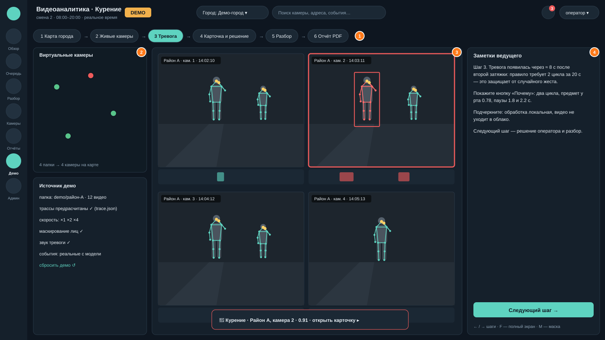

*W7. ① Шаги показа: карта → живые камеры → тревога → карточка → разбор → отчёт. ② Источник демо: локальные папки как виртуальные камеры, скорость, маскирование, звук, сброс. ③ Мультивью 2×2: камера с тревогой подсвечена, на таймлайнах видны циклы. ④ Заметки ведущего к текущему шагу.*

Как устроено:
1. **Папки → виртуальные камеры.** Папка `<район>-<индекс>-<время>` (формат уже поддерживается `realtime/sources.py`) или выбор в мастере: «эта папка — камера 2 района A, координаты на карте». Создаётся демо-город с плашкой DEMO; его данные изолированы флагом `demo` (поле уже есть в `alerts`).
2. **Предрасчёт трасс.** Задача `demo-precompute` один раз прогоняет все видео решателем и сохраняет `trace.json` (треки, циклы, события с моментом подъёма). Во время показа видео играется в темпе ×1–×4, а события «поднимаются» в тот момент, когда их поднял бы живой движок. Поэтому демо **не зависит от железа** ноутбука, и тревоги настоящие, от модели, а не нарисованные.
3. **Режим ведущего:** шаги, заметки, горячие клавиши (← → шаги, F — полный экран, M — маска), сброс в исходное состояние за 1 клик.
4. **Безопасность показа:** маскирование лиц по умолчанию, никаких записей вне демо-города, работа без сети (офлайн-тайлы).
5. **Сценарий на 7 минут:**
   - карта города с маячками (30 с);
   - мультивью, «живые» камеры (1 мин);
   - тревога со звуком (30 с);
   - карточка: «почему» и решение, затем показать ложное с причиной (2 мин);
   - разбор: доля ложных, реакция (1 мин);
   - PDF-отчёт за смену (1 мин);
   - слайд «другие сценарии» (раздел 11, 1 мин).

### 7.6. Веб и десктоп из одного кода

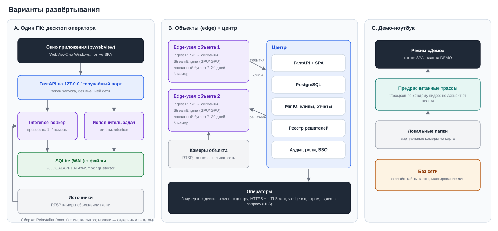

*D10. A — один ПК: десктоп со встроенным сервером. B — объекты (edge) и центр. C — демо-ноутбук.*

**Десктоп = pywebview + встроенный FastAPI + PyInstaller:**
- pywebview открывает окно на системном WebView2 (есть в Windows 10/11) и показывает тот же SPA.
- В фоновом потоке запускается uvicorn на `127.0.0.1` со случайным портом и одноразовым токеном запуска. Токен передаётся в окно, внешние клиенты не подключатся.
- Один экземпляр приложения (блокировка), иконка в трее; уведомления ОС и звук приходят и при свёрнутом окне.
- **Второе окно — видеостена** на втором мониторе (`#/wall`): тот же SPA в другом режиме. Положение окон запоминается.

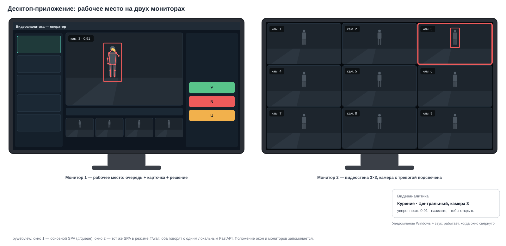

*W8. Монитор 1 — рабочее место (очередь, карточка, решение), монитор 2 — видеостена 3×3 с подсветкой камеры с тревогой; уведомление ОС при свёрнутом окне.*

**Два варианта сборки десктопа:**

| вариант | что внутри | размер | когда |
|---|---|---|---|
| **Тонкий клиент** | pywebview + SPA; подключается к серверу центра (вариант B) | десятки МБ | операторы в ситуационном центре |
| **Автономный** | + FastAPI, воркеры, SQLite, OpenVINO/ONNX Runtime, модели отдельным пакетом | сотни МБ без torch | один объект, 1–4 камеры, демо |

**Сборка:** PyInstaller в режиме onedir (быстрый запуск, обновление отдельных файлов) + инсталлятор (Inno Setup или MSI). Подпись кода сертификатом, иначе SmartScreen пугает пользователя. Данные пользователя лежат в `%LOCALAPPDATA%\<продукт>`. Обновление — через проверку версии на сервере центра или установщиком.

### 7.7. UI/UX: расположение на экране и правила

**Сетка и плотность**

| экран и разрешение | раскладка |
|---|---|
| ≥ 1920×1080 (основное) | рейка навигации 72 px · левая панель 330 px · центр (flex) · правая панель 360–380 px. На W5: очередь, клип и решение видны одновременно, без прокрутки |
| 2560×1440 | правая панель до 420 px, ключевые кадры в 2 ряда; на «Обзоре» карта и лента становятся шире |
| 1366–1600 | правая панель (решение) сворачивается в выезжающую, кнопки Y/N/U остаются под клипом |
| планшет, только чтение | для руководителя: KPI, лента, разбор; решения недоступны |
| два монитора | рабочее место + видеостена (W8) |

**Визуальная иерархия**
1. Самое заметное — то, что требует действия: новые события, SLA, кнопки решения.
2. Затем доказательство: клип, ключевые кадры, «почему».
3. Затем контекст: карта, история, KPI.

Шрифт: основной текст 12–14 px, заголовки панелей 14–15 px, KPI 22–28 px. Цифры моноширинные (`font-variant-numeric: tabular-nums`), чтобы таймеры не «прыгали».

**Цвет — только со смыслом** (тёмная тема для операторских залов, есть светлая):

| цвет | значение | никогда не использовать для |
|---|---|---|
| красный | новое событие, требует действия; «ложное» в кнопке | декора |
| жёлтый | SLA на исходе, «не уверен», предупреждение | подтверждения |
| зелёный | подтверждено, камера онлайн, цель SLA выполнена | новых событий |
| бирюзовый (бренд) | интерактивные элементы, выбранное, ссылки | статусов |
| серый | закрыто, неактивно, нет данных | |

Цвет никогда не единственный носитель смысла: всегда есть подпись или значок (доступность при нарушении цветовосприятия). Контраст текста — не ниже 4.5:1 (WCAG AA).

**Клавиатура**

| клавиши | действие |
|---|---|
| Y / N / U / E | подтвердить / ложное / не уверен / старшему |
| 1–9 | причина ложного |
| J / K | следующее / предыдущее событие |
| Space, ← →, [ ] | пауза, ±5 с, к предыдущему / следующему циклу |
| B, S, M | рамки, скелет, маска лиц |
| Ctrl+Z | отменить решение (10 с) |

Подсказка по клавишам всегда видна внизу правой панели.

**Состояния экранов** (обязательно спроектировать):
- **Пусто:** «Новых событий нет — последнее 12 мин назад» и ссылка на ленту.
- **Загрузка:** скелетоны вместо спиннеров; клип показывает миниатюру, пока грузится.
- **Ошибка:** что случилось и что делать («камера 3 без сигнала 4 мин — сообщено администратору»).
- **Офлайн-сервер:** баннер «нет связи с сервером, события буферизуются», решения ставятся в очередь и отправляются после восстановления.

**Эргономика смены:**
- Звук тревоги — короткий, не раздражающий; громкость и тихие часы настраиваются.
- Никаких мигающих элементов: пульсация маячка мягкая, ≤ 1 Гц.
- Время показывается локально, с относительной подсказкой («2 мин назад»).
- Карточка не меняется под курсором: новые события добавляются в очередь, но текущая карточка остаётся на месте.
- Решение без подтверждающих диалогов: вместо них отмена.

**Что сохранить из текущего веба.** Стиль по референсу заказчика («Frame 1»: рейка круглых иконок, тёмная тема, карточка улицы с кольцами); выбор формата видео клиентом; живой анализ с паузой плеера, когда модель отстаёт; горячие клавиши Y/N/U.

---

## 8. Технический стек и API

### 8.1. Стек

| часть | выбор | почему | лицензия |
|---|---|---|---|
| API-сервер | FastAPI + uvicorn | типизация (pydantic), OpenAPI для интеграторов, SSE, зависимости для auth и прав | MIT / BSD |
| БД | SQLAlchemy 2 + Alembic; SQLite (WAL) → PostgreSQL | один код на двух СУБД, миграции схемы | MIT; PostgreSQL License |
| Артефакты | файловая система; при нескольких узлах — S3-совместимое хранилище | адресация по sha256, дешёвое хранение | MinIO — AGPL-3.0 (только как отдельный немодифицированный сервис); альтернатива SeaweedFS — Apache-2.0 |
| Аналитика | Parquet + DuckDB | SQL по всем прогонам без загрузки в память | Apache-2.0 / MIT |
| Инференс | OpenVINO (CPU/iGPU), ONNX Runtime, CUDA через torch только где нужно | маленькие сборки, без AGPL в рантайме после замены моделей | Apache-2.0 / MIT |
| Dev Studio | Streamlit | быстрый интерфейс для инженера; уже используется | Apache-2.0 |
| SPA оператора | текущий vanilla JS → модульный (ES-модули) или лёгкий фреймворк (Preact/Svelte) с локальной сборкой | без CDN; компоненты карточки, плеера, таймлайна переиспользуются | MIT |
| Карта | MapLibre GL или Leaflet из пакета + офлайн-тайлы (MBTiles, OSM) | работа без интернета | BSD; данные OSM — ODbL (атрибуция) |
| Живое видео | MediaMTX (RTSP → WebRTC/HLS) или ffmpeg HLS | задержка WebRTC < 1 с; HLS проще | MIT; ffmpeg LGPL/GPL (сборка) |
| PDF | ReportLab + matplotlib | без системных зависимостей, кириллица со встроенным шрифтом | BSD; PSF-подобная |
| Десктоп | pywebview + PyInstaller (+ Inno Setup) | один SPA; WebView2 уже есть в Windows | BSD; GPL с исключением для загрузчика (коммерческая поставка разрешена) |
| Аутентификация | сессии в cookie + Argon2id; OIDC (Keycloak, AD FS) для предприятий | стандартно и проверяемо | MIT / Apache-2.0 |

### 8.2. API (v1)

| группа | методы | заменяет нынешнее |
|---|---|---|
| Вход | `POST /api/v1/auth/login`, `POST /auth/logout`, `GET /auth/me` | поле «Оператор» |
| Города и карта | `GET /cities`, `GET /cities/{id}/overview` (KPI), `GET /cities/{id}/map` (GeoJSON районов, объектов, камер) | `/api/stats`, `/api/cameras`, `geo.py` |
| Камеры | `GET /cameras?city=`, `GET /cameras/{id}`, `PATCH /cameras/{id}` (ROI, min_height, solver — admin), `GET /cameras/{id}/health`, `GET /cameras/{id}/live` (WebRTC/HLS) | `/api/camera/<id>` |
| События | `GET /events?city=&status=&district=&camera=&from=&to=&min_conf=&cursor=`, `GET /events/{id}`, `POST /events/{id}/claim`, `GET /events/{id}/history` | `/api/alerts`, `/api/alert/<id>` |
| Решения | `POST /events/{id}/reviews {decision, reason_code, note}`, `POST /events/{id}/reviews/undo` (окно 10 с) | `POST /api/alert/<id>/review` |
| Поток | `GET /events/stream?city=` (SSE: created, updated, closed, reviewed) | опрос раз в 5 с |
| Медиа | `GET /media/events/{id}/clip.mp4` (Range), `/thumb.jpg`, `/keyframes/{n}.jpg`, `/trace.json` | `/media/alert/<id>/…` |
| Инциденты | `POST /incidents`, `PATCH /incidents/{id}` | — |
| Аналитика и отчёты | `GET /analytics/review?…`, `POST /reports {template, params}` → задача, `GET /reports/{id}.pdf` | `/api/journal.csv` |
| Задачи | `GET /jobs`, `GET /jobs/{id}`, `POST /jobs/{id}/cancel` | `/api/job/<id>`, `/api/tasks` |
| Администрирование | `users`, `roles`, `cities`, `sites`, `notifications`, `retention`, `POST /solvers` (только подписанные), `GET /audit` | профили и решатели в вебе → Dev Studio |
| Демо | `POST /demo/setup {folders, mapping}`, `POST /demo/precompute` → задача, `POST /demo/play {speed}`, `POST /demo/reset` | `POST /api/demo` |
| Интеграции | исходящие webhook и MQTT: событие в JSON с подписью HMAC | — |

Пример полезной нагрузки исходящего события:

```json
{"type": "event.created", "event_id": 18342, "scenario": "smoking", "city": "gatchina", "camera_id": "central-03",
 "start": "2026-10-10T10:42:15+03:00", "peak": "2026-10-10T10:42:24+03:00", "confidence": 0.91,
 "box": [412, 188, 498, 455], "rule": "2 cycles / 14 s", "solver_fp": "60a8e78322",
 "clip_url": "/api/v1/media/events/18342/clip.mp4", "signature": "hmac-sha256=…"}
```

### 8.3. Защита веб-слоя

1. **Сессии.** Cookie `HttpOnly; Secure; SameSite=Strict`. Пароли — Argon2id. Ограничение частоты входа, блокировка после N неудачных попыток. Опционально — 2FA и OIDC.
2. **Права (RBAC)** на уровне зависимостей FastAPI:

   | роль | права |
   |---|---|
   | operator | события своих городов |
   | senior | плюс эскалации и разбор |
   | admin | плюс камеры, пользователи, решатели |
   | analyst | только чтение и отчёты |
   | demo | только демо-город |

3. **CSRF и Origin.** Список разрешённых `Host` (защита от DNS rebinding), проверка `Origin` на всех изменяющих запросах, CSRF-токен. POST принимает только `application/json` (закрывает S2).
4. **Валидация имён и путей.** Все идентификаторы — по схеме (pydantic, регулярное выражение). Файлы отдаются только по ключу артефакта, без пути от клиента (закрывает S3).
5. **CSP без внешних источников:** `default-src 'self'`; тайлы и скрипты локальные (закрывает S5).
6. **TLS** через обратный прокси (Caddy или nginx) в варианте B; mTLS между edge и центром.
7. **Аудит:** вход и выход, решения, изменения камер, установка решателей, экспорт, удаление.

### 8.4. Масштабирование

| масштаб | конфигурация |
|---|---|
| 1–4 камеры, один ПК | десктоп «автономный»: SQLite, один inference-воркер, iGPU или CPU |
| 5–30 камер, объект | сервер с NVIDIA (T4/A2/RTX): несколько inference-воркеров с батчингом позы; PostgreSQL; MediaMTX |
| Город, десятки объектов | edge-узлы по объектам + центр (PostgreSQL, хранилище, API); операторы в браузере или тонком десктопе |

Оценка нагрузки — измерением во вкладке «Профилирование». На ноутбуке i3 + iGPU профиль `mvp` держит ≈ 1 камеру 1080p при 5 к/с (rt_factor 1.23–1.33). На GPU-профиль цифр пока нет: `laptop_gpu4` не измерялся, и обещать число камер до замера нельзя.

---

## 9. Безопасность, приватность, право

> Раздел — инженерный анализ, не юридическое заключение. Перед коммерческой поставкой нужна проверка юристом: персональные данные и лицензии.

### 9.1. Персональные данные (152-ФЗ)

- **Видеозапись людей — персональные данные.** Продукт **не распознаёт лица и не устанавливает личность**: работает поза и трек внутри камеры. Это снижает риски (нет биометрической идентификации). Добавлять распознавание лиц без отдельной правовой оценки не следует.
- **Роли сторон.** Обычно оператор ПДн — заказчик (владелец камер). Поставщик платформы обрабатывает данные по его поручению. Это нужно закрепить в договоре и в модели угроз.
- **Минимизация.** Хранить клипы событий и короткое кольцо сегментов, а не весь архив. Сроки — в `RetentionPolicy`, удаление — в аудите.
- **Доступ** по ролям и городам; выгрузки маскируют лица по умолчанию; демо — только на демо-данных или с маскированием.
- **Локальность.** Обработка на объекте или в контуре заказчика, без облака (это требование есть и в правилах хакатона). В SPA нет внешних запросов (CSP).
- **Человек в контуре.** Система **рекомендует**, решает оператор. Это важно для любых последствий для человека, вроде штрафа за курение в запрещённом месте.

### 9.2. Лицензии моделей и данных

| компонент | лицензия | риск для коммерции | мера |
|---|---|---|---|
| YOLO26 и YOLO11 pose (Ultralytics) | AGPL-3.0 | высокий: требование открыть код при сетевом использовании; по позиции Ultralytics, обученные их кодом модели тоже под AGPL без Enterprise-лицензии | купить Ultralytics Enterprise **или** заменить на RTMO / RTMDet + RTMPose (Apache-2.0, OpenMMLab) |
| Детекторы сигареты (Beehzod YOLO11m — в карточке MIT, basant18 YOLO26s — Apache-2.0) | заявлены разрешительные, но обучены кодом Ultralytics | средний: та же позиция Ultralytics | дообучить свой детектор на RTMDet / YOLOX (Apache-2.0) на собственных кропах |
| RTMPose-s/m (rtmlib) | Apache-2.0 (код), веса OpenMMLab | низкий | проверить лицензию конкретных весов |
| CLIP ViT-B/32 (OpenCLIP, LAION-2B) | MIT | низкий; данные LAION — отдельный вопрос | допустимо |
| LightGBM, scikit-learn | MIT, BSD | нет | — |
| VideoMAE (K400) | CC-BY-NC-4.0 | запрещено в коммерции | не включать в выпуски (сейчас и не используется) |
| VLM Qwen (через Ollama) | зависит от версии модели | проверить | опционально; не входит в базовый выпуск |
| Stanford40, HMDB51 | только для исследований | запрещено в обучении коммерческой модели | убрать из обучающих наборов выпусков; `data_external` — из git |
| Наборы Roboflow и Kaggle | по набору (часто CC BY 4.0) | атрибуция | реестр лицензий в манифесте датасета |
| Тайлы OSM | ODbL | атрибуция | подпись на карте |

**Рекомендация.** Решение «купить или заменить» принять на этапе E0. Замена на стек OpenMMLab сохраняет архитектуру: поза — плагин. Нужны переобучение и сверка на «лестнице» (раздел 1.5).

### 9.3. Цепочка поставки и выпуск

- **Веса** — только из реестра с sha256 (`models/registry.lock.json` уже есть). `.pt` из сообщества проверяются (`sd models scan`). В продукт идут только экспортированные IR/ONNX — без pickle.
- **Решатель подписывается** (Ed25519). Продукт ставит только подписанные решатели и показывает отпечаток в карточке события.
- **Зависимости** закреплены (`requirements.lock.txt`); SBOM (CycloneDX) прикладывается к выпуску; сканирование уязвимостей в CI.
- **Сборка в чистой среде** (CI-раннер или чистая ВМ), а не на машине разработки: на ней ранее был найден майнер (раздел 2.3).

---

## 10. Качество модели и MLOps

### 10.1. Петля улучшения

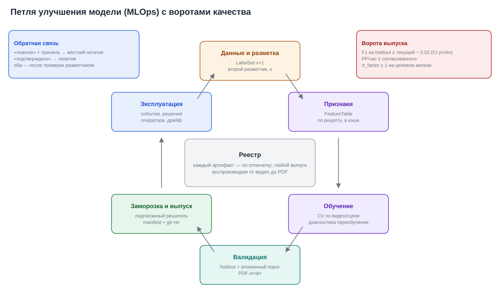

*D9. Данные → признаки → обучение → валидация → заморозка → эксплуатация → обратная связь. Каждый шаг оставляет артефакт с отпечатком, поэтому любой выпуск воспроизводим от видео до PDF.*

### 10.2. Методология оценки

1. **Разбиение по группам** (камера + актёр + дубль): кадры одного видео не бывают одновременно в обучении и проверке.
2. **Вложенный подбор порога:** порог выбирается на внутренних фолдах. Внешняя оценка (0.74–0.76 сейчас) — честная цифра для заказчика.
3. **Holdout заморожен** (хэш списка видео). Используется один раз на выпуск, роль `hidden` запрещает подбор.
4. **Доверительные интервалы всегда:** bootstrap по клипам; сравнение версий — парным bootstrap.
5. **Метрики по тегам сценариев** P01–P08 и N01–N08 показывают, где именно модель ошибается.

### 10.3. Ворота выпуска (пример, согласовать с заказчиком)

| ворота | условие |
|---|---|
| Качество | F1 на holdout ≥ F1 текущего выпуска − 0.02, с учётом CI (не хуже статистически) |
| Ложные | FP в час на негативных клипах ≤ согласованного значения |
| Скорость | rt_factor ≥ 1.0 на целевом железе при заявленном числе камер |
| Живой режим | все признаки классификатора доступны в потоке (нет `ClassifierRequired`) |
| Право | все веса и данные выпуска с коммерческой лицензией |
| Воспроизводимость | манифест полон, PDF приложен, подпись есть |

### 10.4. Как измерять качество в эксплуатации

- **Точность** измеряется прямо: подтверждённые / (подтверждённые + ложные), по камерам и версиям решателя.
- **Полнота** по решениям операторов не видна: пропуски никто не отмечает. Нужен **аудит пропусков**: разметчик раз в неделю просматривает случайную выборку часов видео (или клипы с оценкой цикла чуть ниже порога) и отмечает пропущенные эпизоды.
- **Дрейф:** распределения роста людей, уверенности точек, частоты циклов, оценок цикла и доли ложных по камере сравниваются с эталоном (PSI). Резкое изменение — сигнал (сдвинули камеру, зима, ИК-подсветка).
- **Калибровка уверенности эпизода** (P1-2): isotonic по накопленным решениям операторов для конкретной версии решателя. Тогда «уверенность 0.9» значит ≈ 90 % подтверждений, и фильтр «уверенность не ниже» становится полезным.

### 10.5. Пилот у заказчика (протокол)

1. **Неделя 0:** установка; настройка ROI и минимального роста по каждой камере; лестница на кадрах этих камер (рост людей → выбор imgsz и fps).
2. **Неделя 1, теневой режим:** события видит только аналитик команды. Он размечает подтверждение, ложное или неясное и проводит аудит пропусков.
3. **Неделя 2, боевой режим:** события получают операторы. Измеряются точность, реакция, доля «не уверен».
4. **Отчёт пилота** (PDF): качество с CI по камерам, ложные по причинам, время реакции, рекомендации (камеры, требующие перенастройки).

### 10.6. Ближайшие улучшения модели (по ожидаемой отдаче)

1. Второй разметчик и дальние ракурсы — без них нельзя доказать любое улучшение.
2. Признаки предмета в потоке (кропы из FrameRing) — полный классификатор в живом режиме.
3. Онлайн-склейка треков — убирает класс ошибок `wrong_box` и FN + FP.
4. Дальняя зона: imgsz 1280–1600 по ROI, тайлинг людей, проверка на лестнице.
5. Свой детектор сигареты на кропах своих камер (снимает и проблему лицензии).
6. Жёсткие негативы «питьё / телефон / касание» из решений операторов.

---

## 11. Расширение на другие сценарии видеоаналитики

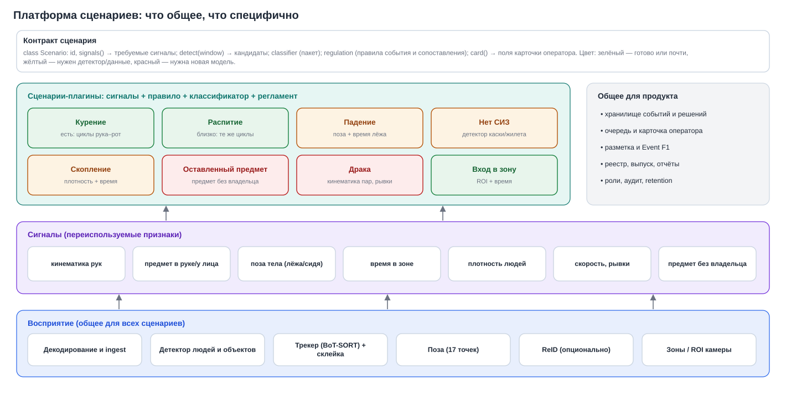

*D12. Восприятие (детекция, трек, поза, зоны) и продукт (события, оператор, разметка, оценка, выпуск) общие. Сценарий — плагин: требуемые сигналы, правило, классификатор, регламент и поля карточки.*

### 11.1. Контракт сценария

```python
class Scenario(Protocol):
    id: str                                   # "smoking", "fall", "ppe", ...
    signals: tuple[str, ...]                  # требуемые сигналы: "hand_kinematics", "object_near_mouth", "body_lying", ...
    def candidates(self, window: TrackWindow) -> list[Candidate]: ...   # «циклы» сценария
    classifier: BundleRef | None              # пакет модели кандидата
    regulation: Regulation                    # правило события + протокол сопоставления (Event F1 со своими допусками)
    def card(self, event: Event) -> CardSpec: ...                       # что показать оператору в «почему»
```

Курение уже устроено по этому шаблону: кандидаты — циклы рука–рот, классификатор — `cycle_mvp`, регламент — «2 цикла за 20 с». Новый сценарий не меняет очередь, карточку, разбор, отчёты, разметку и оценку.

### 11.2. Каталог сценариев

| сценарий | сигналы | переиспользуется | новое | сложность |
|---|---|---|---|---|
| Распитие в общественном месте | циклы рука–рот, предмет (бутылка, банка), длительность | почти всё: автомат циклов, оценка | детектор бутылки и банки, регламент | низкая |
| Вейпинг (школы, ТЦ) | те же циклы, малый предмет | всё | детектор вейпа; кропы крупнее | средняя |
| Курение в запрещённой зоне (АЗС, склад) | курение + ROI | всё | зоны и правило «в зоне» | низкая |
| Падение человека | поза «лёжа», резкое снижение центра масс, время без движения | поза, трек | классификатор позы тела, регламент времени | средняя |
| Отсутствие СИЗ (каска, жилет) | детектор СИЗ на треке, зоны | трек, зоны, карточка | детектор СИЗ, данные объекта | средняя |
| Скопление людей | плотность, время | детектор людей | правило плотности по зоне | низкая |
| Проход в запрещённую зону | ROI + время + направление | трек | редактор зон | низкая |
| Оставленный предмет | предмет без владельца N минут | детектор объектов, трек | ассоциация «предмет–человек» | высокая |
| Драка или агрессия | кинематика пар людей, рывки | поза, трек | классификатор пар, данные | высокая |

### 11.3. Продуктовое обоснование

- **Где ценность.** Курение — точка входа с понятной метрикой и регламентом. Деньги приносит платформа: одна установка, общий оператор, много сценариев на тех же камерах. Каждый новый сценарий дешевле предыдущего, потому что восприятие и продукт уже есть.
- **Сегменты:**
  - города (остановки, детские площадки, входы в учреждения);
  - транспорт (вокзалы, платформы);
  - промышленность и логистика (курение у опасных объектов, СИЗ);
  - торговые центры;
  - образование (вейпинг).

  Для первых пилотов с ясной экономикой подходят промышленность и опасные объекты: там курение и отсутствие СИЗ — прямой риск аварии.
- **Модель продаж:**
  - лицензия за камеру и сценарий в месяц;
  - установка на объекте (on-prem);
  - пилот 2–4 недели с отчётом (раздел 10.5);
  - SDK сценариев для партнёров-интеграторов.

  В материалах проекта (`docs/presentation/presentation_text.md`) продукт уже позиционируется как модуль более широкой платформы видеоаналитики.
- **Отличия от «просто детектора»:**
  - событие по регламенту (человек, время, рамка) вместо кадра;
  - объяснение «почему»;
  - честная оценка с CI;
  - локальная обработка без облака;
  - петля обратной связи от оператора.

---

## 12. Риски и меры

| риск | вероятность | влияние | мера | когда |
|---|---|---|---|---|
| Качество на дальних камерах (80–200 px) ниже обещанного | высокая | высокое | лестница на кадрах заказчика до договора; imgsz 1280–1600, ROI, тайлинг; честная зона гарантии в настройках камеры | E1, пилот |
| Мало эталонных данных: один разметчик, 23 эпизода | высокая | высокое | второй разметчик, κ, holdout, теневой режим пилота | E1 |
| Лицензия AGPL (Ultralytics) | высокая | высокое | Enterprise-лицензия или замена на OpenMMLab; решение в E0 | E0 |
| Атака на веб-API (CSRF, чтение файлов) | средняя | высокое | исправления S1–S6, FastAPI с auth и CSRF, CSP | E0, E3 |
| Персональные данные и претензии регулятора | средняя | высокое | роли сторон в договоре, retention, маскирование, аудит, без распознавания лиц | E3 |
| Ложные тревоги утомляют операторов («слепота к тревогам») | средняя | высокое | калибровка, порог по камере, жёсткие негативы, мониторинг доли ложных | E3, эксплуатация |
| Не хватает производительности на объекте | средняя | среднее | профилирование до поставки, OpenVINO/GPU, fps 5 против 10, ROI | E2 |
| Расхождение offline и потока | средняя | среднее | один движок, replay-сверка в CI, признаки предмета из FrameRing | E1 |
| Демо подводит из-за железа или сети | средняя | среднее | предрасчёт трасс, офлайн-тайлы, проверка перед показом | E4 |
| Переобучение на одном признаке (`obj_any_max_conf`) | средняя | среднее | диагностика в обучении, данные с другими детекторами и ракурсами | E2 |
| Скомпрометированная машина разработки | известный факт | высокое | чистая сборочная среда, подпись решателей, ротация паролей | E0 |
| Зависимость от одного разработчика и ассистента | средняя | среднее | документация (этот документ), CI, код-ревью, типизированные модули | всегда |

---

## 13. Дорожная карта

Оценки — для команды из 1–2 разработчиков и 1 ML-инженера. Это ориентир для планирования, а не обязательство: точность ±30 %.

| этап | содержание | готово, когда | оценка, чел.-нед. |
|---|---|---|---|
| **E0. Гигиена** | исправить S2–S5 (Origin/CSRF, `_check_name` при чтении профиля, CSP, локальные Leaflet и тайлы); решение по AGPL; `data_external` и кадры площадки — из git; собрать и проверить Docker-образ; убрать `operator-app` из `launch.json`; чистая сборочная среда | смоук-тест в `--network none`; образ собирается в CI | 1–2 |
| **E1. Ядро и данные** | `sd.core` и `sd.engine` (Stage API, pydantic-конфигурация); ArtifactStore с манифестами; LabelStore с версиями; единый стек обучения; очередь `jobs`; признаки предмета в потоке; онлайн-склейка треков; второй разметчик | `sd eval` воспроизводим по манифесту; replay = offline на 3 клипах; κ посчитан | 5–7 |
| **E2. Dev Studio** | 7 вкладок (раздел 6); PDF-отчёт прогона; анализ кэша на DuckDB; обучение и реестр; выпуск с подписью и воротами | PDF прогона mvp совпадает с `report.json`; выпуск ставится в продукт | 4–5 |
| **E3. Продукт оператора (веб)** | FastAPI v1, вход и роли, аудит; города, районы, объекты, камеры; очередь и карточка с объяснением; Review append-only; SSE; разбор и отчёты; уведомления; retention | оператор обрабатывает событие за ≤ 2 действия; история решений неизменяема; отчёт смены в PDF | 6–8 |
| **E4. Десктоп и демо** | pywebview (тонкий и автономный), PyInstaller + инсталлятор, видеостена; демо-город, предрасчёт трасс, режим ведущего, маскирование | установка на чистый Windows за < 10 мин; 7-минутный показ без сети | 3–4 |
| **E5. Второй сценарий** | контракт Scenario; распитие или курение в зоне (низкая сложность); метрики по сценарию | второй сценарий в той же очереди без изменения продукта | 3–6 |

**Первые две недели (быстрые шаги с большой отдачей):**
1. S2 и S3 — две небольшие правки, закрывают реальные уязвимости.
2. Решение по лицензии AGPL (купить или заменить) — от него зависит вся поставка.
3. Сборка Docker-образа и проверка `--network none`.
4. Второй разметчик на 10–15 клипов и метрика согласия.
5. Записи с дальних камер (или запрос их у заказчика) и лестница на них.

---

## 14. Приложения

### 14.1. Глоссарий

| термин | значение |
|---|---|
| Цикл жеста | рука ко рту → пауза 0.5–5 с → отвод; единица, которую оценивает классификатор |
| Эпизод (событие) | один или несколько циклов одного человека, склеенных по регламенту |
| d_t | расстояние запястье–рот в ширинах плеч |
| Event F1 | F1 по эпизодам с допуском ±3 с, IoU рамки ≥ 0.30 в peak, один-к-одному |
| IGNORE | интервал, где ошибки не считаются (человек < 80 px и пр.) |
| oof (out-of-fold) | оценка моделью, которая не видела это видео при обучении |
| Вложенный подбор порога | порог подбирается внутри обучающих фолдов, оценка — на внешнем |
| Профиль | конфигурация конвейера (`configs/experiments/*.yaml`) |
| Решатель | пакет для выпуска: профиль + классификатор + веса + манифест (`.sdsolver.zip`) |
| Отпечаток (fingerprint) | хэш конфигурации и sha256 весов: «та же модель или нет» |
| rt_factor | секунды видео на секунду вычислений; ≥ 1 — успевает в реальном времени |
| Жёсткий негатив | пример, на котором модель ошиблась (питьё, телефон…) и который добавлен в обучение |
| SSE | Server-Sent Events: поток событий от сервера в браузер |

### 14.2. Смежные документы репозитория

| документ | о чём |
|---|---|
| `docs/FINAL.md` | итоговая конфигурация `mvp`, замеры качества и скорости |
| `docs/MVP.md` | эталон событий, oof-оценка, что не помогло, лестница |
| `docs/ARCHITECTURE.md` | текущая архитектура (версии 3–6), изменения по итерациям |
| `docs/WEB_APP.md` | экраны текущего веб-приложения |
| `docs/REALTIME.md`, `docs/SOLVER_AND_STREAM.md` | движок потока, решатель, replay |
| `docs/AUDIT_AND_CHANGES.md` | аудит, приоритеты P0–P2 (§7, §12) |
| `docs/DOCKER.md`, `docs/OPERATIONS.md`, `docs/CLI.md` | запуск, эксплуатация, команды |

### 14.3. Сводка текущих чисел

| величина | значение | источник |
|---|---|---|
| Видео с метками | 31 клип, 60.6 мин (19 «курение» + 12 «лжекурение») | `docs/ANALYSIS.md` |
| Эпизоды в оценке | 23 в 9 клипах | `docs/FINAL.md` |
| Строки эталона событий | 99 (25 POSITIVE, 11 NEGATIVE, 63 IGNORE, 32 клипа) | `labels/events_gt.csv` |
| Метки жестов | 505 окон: 131 затяжка, 142 нет жеста, 102 неясно, 84 касание, 28 питьё, 18 телефон | `docs/review/gesture_gt.csv` |
| Event F1 (5 к/с / 10 к/с / вложенный) | 0.780 / 0.829 / 0.74–0.76 | `docs/FINAL.md`, `docs/MVP.md` |
| oof AUC цикла (`cycle_mvp`) | 0.856 [0.76–0.94]; train 0.923; перестановка ≈ 0.4 | диагностика классификатора |
| Найдено затяжек автоматом | 82 % (10 к/с), 74 % (5 к/с) | `docs/FINAL.md` |
| Скорость (i3 + iGPU, 5 к/с) | 1.23–1.33× на 1080p; 0.69–0.78 плотные; 0.54 4K | `docs/FINAL.md` |
| Стоимость признаков | предмет 1.8 с/цикл, CLIP 0.7 с/цикл, VLM ≈ 11 с/цикл | `docs/FINAL.md`, `docs/MVP.md` |
| Код и тесты | ≈ 19.9 тыс. строк Python; 380 тестовых функций | подсчёт по репозиторию |

### 14.4. Список схем и макетов

| файл | что изображено |
|---|---|
| `d01_event_matching.svg` | событие, циклы, правило, сопоставление |
| `d02_pipeline.svg` | конвейер и стоимость этапов |
| `d03_cycle_fsm.svg` | автомат цикла |
| `d04_target_architecture.svg` | слои целевой архитектуры |
| `d05_two_modes.svg` | два режима над общим ядром |
| `d06_data_model.svg` | модель данных |
| `d07_lineage_cache.svg` | происхождение артефактов и кэш |
| `d08_event_lifecycle.svg` | жизненный цикл события |
| `d09_mlops_loop.svg` | петля MLOps |
| `d10_deployment.svg` | варианты развёртывания |
| `d11_realtime_engine.svg` | движок реального времени |
| `d12_scenario_platform.svg` | платформа сценариев |
| `w01`–`w03` | Dev Studio: валидация, анализ кэша, обучение |
| `w04`–`w07` | оператор: обзор города, очередь и карточка, разбор, демо |
| `w08` | десктоп на двух мониторах |

Схемы и макеты нарисованы без реальных кадров камер: люди на макетах — схемы, числа на макетах дев-режима взяты из прогона `20261009_085252_mvp`, числа на макетах оператора — иллюстративные.
