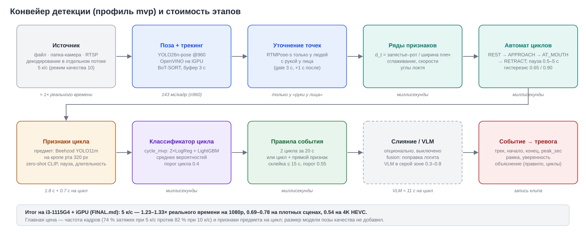

# Состояние проекта и доработка до коммерческого этапа

> 14 октября 2026. База — коммит `37e0366` и изменения последних итераций: Dev Studio (аналитика подходов, конструктор архитектуры, «Лаборатория»), порядок в документации, бэкенд платформы ([API.md](API.md)).
> Документ — главный отчёт «где мы сейчас»:
> - что работает;
> - насколько можно доверять цифрам;
> - что сделано на пути к коммерческому продукту и что осталось — с приоритетами и критериями готовности.
>
> Целевая картина продукта (архитектура, модель данных, экраны оператора, право, расширение на другие сценарии) — в [PLATFORM_GUIDE.md](PLATFORM_GUIDE.md); здесь — состояние относительно неё.

## Содержание

1. [Кратко](#1-кратко)
2. [Контекст: задача, заказчик, рынок](#2-контекст-задача-заказчик-рынок)
3. [Что есть сейчас: компоненты и готовность](#3-что-есть-сейчас-компоненты-и-готовность)
4. [Качество: числа и насколько им доверять](#4-качество-числа-и-насколько-им-доверять)
5. [Производительность](#5-производительность)
6. [Доработка до коммерческого этапа: статус по дорожной карте](#6-доработка-до-коммерческого-этапа-статус-по-дорожной-карте)
7. [Риски](#7-риски)
8. [Что делать дальше](#8-что-делать-дальше)
9. [Карта документации](#9-карта-документации)
- [Приложение А. История измерений и решений](#приложение-а-история-измерений-и-решений)

---

## 1. Кратко

**Что это.** Локальный детектор курения по записям и потокам обычных камер наблюдения. Он находит не «сигарету в кадре», а **событие**: конкретный человек (трек) в конкретный интервал времени, с рамкой и уверенностью. Решение строится по регламенту:
- цикл жеста «рука ко рту → пауза → отвод»;
- событие — два цикла за 20 с, или цикл + прямой признак;
- склейка циклов одного человека — не больше 15 с.

Всё считается на ноутбуке без видеокарты (i3-1115G4, встроенная графика через OpenVINO), без облака.

**Где мы.** Работающий MVP плюс инструментарий разработчика коммерческого уровня. Продукт оператора — пока прототип.

| | состояние |
|---|---|
| Ядро распознавания | работает; один код для офлайна, имитации потока и потока |
| Dev Studio (`sd ui`) | готово: валидация с PDF, анализ слабых мест, аналитика подходов, конструктор архитектуры, «Лаборатория» (этапы на клипе, модели по рядам, дообучение, активное обучение), разметка с версиями, обучение и диагностика классификатора, выпуск через ворота качества |
| Бэкенд платформы (`sd serve`) | **готов** ([API.md](API.md)): FastAPI, вход и 4 роли, журнал действий, БД с миграциями (SQLite / PostgreSQL), история решений, поток обновлений, доступ к функциям разработчика. Не проверен на PostgreSQL и под нагрузкой |
| Веб-приложение оператора (`sd app`) | прототип: карта, тревоги с решением Y/N/U, анализ видео. Без входа и ролей; на новый API не переведён |
| Поток с камер | движок есть и проверен на имитации (папки с фрагментами); RTSP к монитору не подключён |
| Поставка | переносимый решатель `.sdsolver.zip`; Docker-образ ни разу не собирался |

**Ключевые числа** (31 клип с площадки, 23 эпизода курения, разметка команды):

| что | значение | можно ли верить |
|---|---|---|
| Event F1, профиль `mvp` (5 к/с, реальное время) | **0.780** [0.67–0.91] | оптимистично: классификатор обучен на 29 из 31 клипа оценки |
| Event F1, режим качества (10 к/с) | **0.829** [0.74–0.94] | оптимистично: обучен на 28 из 31 |
| **Честная оценка** (вложенный подбор порогов, классификатор не видел видео), набор `obj_hold_zsd` | **0.74–0.76** | да, в пределах этих 31 клипа |
| Скорость на i3 + iGPU, 5 к/с, 1080p | 1.23–1.33× реального времени; плотные сцены 0.69–0.78; 4K 0.54 | замеры на 3–5 клипах |

**Главное, что нужно сделать до коммерческого пилота** (подробно — раздел 8):
1. Отложенная выборка и второй разметчик — без них любое «улучшение» неотличимо от шума эталона.
2. Записи дальних камер (люди 80–200 px): на них качество не измерено, а это основной режим реальных камер.
3. Решение по лицензии Ultralytics (AGPL-3.0): купить или заменить модели позы и детекторы.
4. Перевод веб-интерфейса на новый API (вход и роли уже есть в бэкенде), сборка Docker-образа, проверка на PostgreSQL.
5. Остаток продукта оператора (этап E3): доступ по городам и районам, отчёты смен, уведомления.

---

## 2. Контекст: задача, заказчик, рынок

- **Задача** — кейс хакатона Videofor × «Сириус» (команда №4). Детекция курения на записях стационарных камер; метрика — **Event F1** по эпизодам. Совпадение засчитывается, если:
  - интервалы перекрываются с допуском ±3 с;
  - рамки в момент пика совпадают с IoU ≥ 0.30;
  - пары сопоставлены один к одному.

  Регламент: люди ниже 80 px — IGNORE; порог фиксируется до скрытого набора; данные площадки обрабатываются только локально.
- **Позиционирование** — модуль платформы видеоаналитики Videofor, которая уже работает на муниципальных объектах. Детектор работает на уже установленных камерах, без замены оборудования и без видеокарты. На той же основе (поза + трек + события) строятся следующие модули: падения, СИЗ, скопления, оставленные предметы, опасное поведение — см. [PLATFORM_GUIDE.md](PLATFORM_GUIDE.md), раздел 11.
- **Рынок** (данные командной презентации, источники — Ivideon и Tebiz Group (2026), в этом отчёте не перепроверялись):
  - рынок видеоаналитики РФ: 4 млрд ₽ (2021) → 9,4 млрд ₽ (2025) → 31 млрд ₽ (прогноз 2030);
  - нейросетевая аналитика растёт примерно на 40 % в год;
  - 76,2 % профессионального видеонаблюдения — локальные системы;
  - 57 % рынка камер — бюджетный сегмент.

  Отсюда требования: локальная обработка, обычные камеры, слабое железо.
- **Конкуренты** (по той же презентации):

  | компания | сильная сторона | ограничение |
  |---|---|---|
  | ACTi | готовая система | часть решений привязана к своему оборудованию |
  | viAct | много модулей | стоимость масштабирования считается отдельно |
  | DIVITEC | есть детекция курения | одна из конфигураций требует специальных камер |

  Наше отличие:
  - событие по регламенту с объяснением «почему»;
  - честная оценка с доверительными интервалами;
  - работа на имеющихся камерах и ноутбуке без GPU;
  - петля обучения на решениях оператора.
- **Модель продаж** (предложение): подписка за камеру или объект и сценарий; установка на объекте; пилот 2–4 недели с отчётом ([PLATFORM_GUIDE.md](PLATFORM_GUIDE.md), разделы 10.5 и 11.3).

---

## 3. Что есть сейчас: компоненты и готовность

*D2. Конвейер профиля `mvp`. Подробное устройство — [ARCHITECTURE.md](ARCHITECTURE.md).*

| компонент | модули | готовность | чем подтверждено |
|---|---|---|---|
| Распознавание: поза → трек → ряды d_t → автомат циклов → признаки цикла → классификатор → правила | `pipeline`, `stages`, `pose_track`, `features`, `cycles`, `evidence`, `photo_*`, `bundle`, `events` | **рабочее** | прогоны оценки по 31 клипу, тесты |
| Оценка по протоколу организаторов | `evaluate`, `evaluation`, `runner`, `experiments` | **рабочее** (копия протокола; официального валидатора нет) | тесты протокола, журнал прогонов |
| Честная оценка и обучение классификатора | `oof_eval`, `classifier`, `bundle`, `cycle_models` | **рабочее**; два стека обучения ещё сосуществуют (`train.py` — устаревший) | диагностика переобучения, вложенная oof-оценка |
| Dev Studio | `ui/*`, `tasks`, `reports`, `cache_analysis`, `compare`, `arch`, `data_catalog`, `labels_history`, `gestures`, `release` | **готово** ([DEV_STUDIO.md](DEV_STUDIO.md)) | 36 дымовых тестов разделов, 16 тестов бэкенда, проверка в браузере |
| Движок потока и монитор | `realtime/*` | **каркас**: имитация камер (папки), тревоги в SQLite | тесты и replay; RTSP не подключён |
| Веб-приложение оператора (прежний прототип) | `web/*` (stdlib HTTP + vanilla JS) | **прототип** ([WEB_APP.md](WEB_APP.md)): без входа и ролей; заменяется веб-интерфейсом ниже | тесты API, проверка в браузере (заглушки моделей) |
| **Веб-интерфейс платформы** (`/app`) | `server/static/*` (vanilla JS, SVG, без сборки и внешних запросов) | **рабочий** ([WEB_UI.md](WEB_UI.md)): 11 разделов по ролям, зелёная палитра, шрифты Geologica и IBM Plex Mono; часть блоков — заглушки с указанием маршрута | 16 тестов (раздача, целостность, контракт с API, отчёты), проверка в браузере на живом сервере; Firefox/Safari и печать в PDF не проверялись |
| **Бэкенд платформы** (API, БД, миграции) | `server/*` (FastAPI + SQLAlchemy + Alembic) | **готов к подключению веба** ([API.md](API.md)): вход и роли, 70 маршрутов, история решений, поток обновлений, доступ к функциям разработчика, перенос из прежней базы | 29 тестов, живой запуск `sd serve`; PostgreSQL и Docker-образ не проверялись |
| Переносимый решатель | `solver`, `cli_solver`, `release` | **рабочее**; подпись — HMAC (`SD_RELEASE_KEY`), не асимметричная | тесты установки и проверки целостности |
| Docker | `Dockerfile`, `docker-compose*.yml` | **не проверено** — образ не собирался | только `docker compose config` |

**Объём кода:** ≈ 23 тыс. строк Python в `src/sd`; тесты — раздел 8 «Как проверено» в [DEV_STUDIO.md](DEV_STUDIO.md).

---

## 4. Качество: числа и насколько им доверять

### 4.1. Данные и разметка

| что | количество | примечание |
|---|---|---|
| Видео | 38 файлов ≈ 89 мин | `data/курение` 19 (39 мин), `data/лжекурение` 12 (21.5 мин), `data/custom` 7 (28.8 мин, размечен 1) |
| Эталон событий (`labels/events_gt.csv`) | 99 строк в 32 клипах: 25 POSITIVE, 11 NEGATIVE, 63 IGNORE | в оценке — 23 эпизода в 9 клипах; 12 из 19 клипов «курение» целиком IGNORE (затяжки не подтверждены) |
| Метки жестов (`labels/review/gesture_gt.csv`) | 505 окон: затяжка 131, нет жеста 142, неясно 102, касание лица 84, питьё 28, телефон 18 | один разметчик (ассистент), согласованность не измерена |
| Таблица обучения классификатора | 217 размеченных циклов (103 затяжки) из 28 видео | — |
| Рост людей в кадре | медиана 377 px (5 % < 150 px, 1 % < 80 px) | скрытый набор и реальные камеры — 80–200 px |

**Найденные проблемы данных** (вкладка «Данные → Проблемы»):
- клипы `smoking_noyabrsk_2/3` лежат в папке «лжекурение», но в них курят (6 эпизодов) — слабая метка папки неверна;
- 6 из 7 клипов `data/custom` не размечены.

### 4.2. Результаты

| конфигурация | Event F1 [95 %] | P / R | TP / FP / FN | источник |
|---|---|---|---|---|
| `mvp`, 5 к/с (рабочая) | 0.780 [0.67–0.91] | 0.89 / 0.70 | 16 / 2 / 7 | прогон `20261011_024126_mvp` (= `20261009_083158_mvp`) |
| `mvp` + `cycle_mvp10`, 10 к/с (режим качества) | 0.829 [0.74–0.94] | 0.94 / 0.74 | 17 / 1 / 6 | `20261009_085252_mvp` |
| прежний `cycle_fast` (кинематика) | 0.541 [0.29–0.73] | 0.71 / 0.43 | 10 / 4 / 13 | `20261008_021635_baseline` |

**Честная оценка наборов признаков** (`sd oof-eval`: оценку цикла даёт модель, не видевшая видео; пороги подбираются вложенно):

| набор признаков | признаков | AUC цикла [95 % по видео] | F1 событий (вложенный, мин–макс) |
|---|---|---|---|
| `fast` (кинематика, ритм, поза) | 40 | 0.65 [0.46–0.81] | 0.61–0.68 |
| `obj_hold` (предмет + пауза) | 4 | 0.87 [0.79–0.94] | 0.60–0.64 |
| **`obj_hold_zsd`** (предмет + пауза + zero-shot CLIP) — рабочий | 6 | **0.87 [0.78–0.94]** | **0.74–0.76** |
| `obj_hold_vlm` (+ VLM, ≈ 11 с на цикл) | 5 | 0.87 [0.79–0.94] | 0.79 |
| `full` (все группы; прогон 12.10 из Dev Studio) | 42 | 0.76 [0.67–0.89] | 0.57–0.67 |

**Выводы:**
- Короткие наборы признаков лучше длинных: на ≈ 200 циклах длинный список переобучается (`full` хуже `obj_hold_zsd`).
- VLM даёт +0.03–0.04 при цене 11 с на цикл — в пределах шума.
- Значим по сути один признак — уверенность детектора предмета у рта. Модель хрупкая к смене детектора и ракурса.

### 4.3. Почему цифрам 0.78–0.83 нельзя верить как обещанию заказчику

1. **Утечка обучения.** `cycle_mvp` обучен на 29 из 31 клипа оценки, `cycle_mvp10` — на 28. Dev Studio теперь показывает это в чек-листе запуска, в результате, в PDF и в воротах выпуска. Ворота не пропускают `mvp` в продукт именно по этой причине.
2. **Один разметчик, 23 эпизода.** Интервал ±0.1; одна ошибка на скрытом наборе из 12 позитивов сдвигает F1 на 4–8 пунктов.
3. **Нет дальних ракурсов.** Лестница вычислений (имитация дальней камеры):
   - при росте ≈ 130 px YOLO26n@960 находит 7 из 16 затяжек, @1280 — 14, @1600 — 15;
   - при ≈ 90 px любая настройка находит 2–4 из 16.
4. **Нет официального валидатора** — `evaluate.py` воспроизводит протокол по руководству.

**Честная цифра на сегодня — 0.74–0.76 F1** на клипах такого типа. Для дальних камер качество не измерено.

---

## 5. Производительность

| что | значение | источник |
|---|---|---|
| Профиль `mvp`, 5 к/с, 1080p | 1.23–1.33× реального времени (3 клипа без плотных жестов) | `sd replay` |
| Плотная сцена (10 циклов за 66 с) | 0.69–0.78× | `sd replay` |
| 4K HEVC | 0.54× | `sd replay` |
| 10 к/с (режим качества), по замерам кэша | 0.27–1.48×, медиана 0.74 | Dev Studio, «Анализ кэша» прогона `20261009_085252_mvp` |
| Найдено затяжек автоматом | 82 % при 10 к/с, 74 % при 5 к/с (131 метка) | лестница вычислений |
| Признаки цикла | предмет 1.8 с, CLIP 0.7 с, VLM ≈ 11 с на цикл | замеры `enrich` |
| Поза | YOLO26n@960 на iGPU: 18.7 к/с одна; с RTMPose-s ≈ 8 к/с; сквозная ≈ 9.5 к/с | бенчмарк 7.10 |

Главная цена качества — частота кадров (5 → 10 к/с: +8 п.п. найденных затяжек, ×2 время) и вход позы для дальних людей. Размер модели позы качества не добавил. GPU-профиль (`archive/laptop_gpu4.yaml`) не измерялся.

---

## 6. Доработка до коммерческого этапа: статус по дорожной карте

Этапы E0–E5 — из [PLATFORM_GUIDE.md](PLATFORM_GUIDE.md), раздел 13. Обозначения: ✅ сделано, 🟡 частично, ⬜ не начато.

### E0. Гигиена (безопасность, лицензии, сборка)

| пункт | статус | что сделано / что осталось |
|---|---|---|
| Чтение произвольного YAML через `/api/profile/<имя>` (S3) | ✅ | `profiles.load_named` во всех местах веба, где имя приходит из браузера; нет профиля — 404 |
| Неверная справка `sd recognize`, битая запись `launch.json` | ✅ | исправлено |
| Жёсткие пути в обход `SD_MODELS` | ✅ | `paths.CYCLE_MODELS`, `PHOTO_MODELS`, `CLASSIFIER_SPECS`, `REVIEW`, `ANALYSIS_IMG` |
| CSRF и проверка Origin/Host в веб-API (S2) | 🟡 | **новый API** защищён конструкцией (cookie только для чтения, изменения только с заголовком, CORS по списку); **прежнее** приложение (`sd app`, :8502) по-прежнему открыто — его замена переводом интерфейса на `/api/v1` |
| Вход, роли и аудит | ✅ | `sd serve`: токены, API-токены, 4 роли, журнал действий, блокировка подбора пароля ([API.md](API.md), раздел 4); в прежнем приложении нет |
| Leaflet и тайлы карты с внешних CDN (S5) | ⬜ | противоречит локальности; нужен локальный Leaflet и офлайн-тайлы |
| Лицензия Ultralytics (AGPL-3.0) для позы и детекторов | ⬜ | решение владельца: Enterprise-лицензия или замена на RTMO/RTMDet (Apache-2.0); ворота выпуска показывают предупреждение |
| Сборка Docker-образа | ⬜ | `docker compose build && docker compose run --rm cli doctor` на машине с Docker |
| Кадры площадки в истории git | 🟡 | из `docs/` убраны в этой итерации, но **остаются в истории** коммитов, уже отправленных в `origin` (github.com/onevay/sirius-sd). Если репозиторий публичный — переписать историю или закрыть доступ (решение владельца) |
| `data_external` в git | ✅ | не отслеживается |
| Чистая среда сборки выпусков | ⬜ | на машине разработки ранее найден майнер — выпуски для заказчика собирать на чистой машине или в CI |

### E1. Ядро и данные

| пункт | статус | что сделано / что осталось |
|---|---|---|
| Очередь фоновых задач | ✅ | `tasks.py` + `task_wrapper.py`: `task.json` / `state.json` без гонки, очередь тяжёлых задач, прогресс, стоп и повтор; исправлено зависание фоновых процессов на Windows |
| Таблица обучения из конкретного прогона (не «последнего») | ✅ | `oof_eval.collect(from_run=…)`, `--run` у `enrich`, `oof-eval`, `clf …`; источник и отпечаток меток — в манифесте пакета |
| Видео обучения в пакете и защита от утечки | ✅ | `bundle.training_videos` / `leak`; `evaluate_dirs` предупреждает, на роли hidden отказывает |
| Переносимые пути журнала | ✅ | двойной токен `$ROOT/$OUTPUTS/…` исправлен — 9 прогонов снова читаются |
| Версии разметки | ✅ | `labels_history`: снимки перед массовыми правками, отличия, откат (файловое хранилище, без БД) |
| Описание всех параметров конфигурации | ✅ | комментарии ко всем 99 параметрам `configs/default.yaml` — из них подсказки конструктора |
| Единый стек обучения | 🟡 | основной путь — спецификация (`classifier.py`); устаревший `train.py` (joblib) и `sd train` ещё в коде |
| Типизированная конфигурация (pydantic) | ⬜ | сейчас dict с проверкой ключей |
| Признаки предмета и фото в живом потоке | ⬜ | в потоке без исходного файла годится только быстрый классификатор; нужны кропы из `FrameRing` |
| Онлайн-склейка треков | ⬜ | смена ID делит эпизод на 1 TP + 1 FP |
| Второй разметчик и согласие разметчиков (κ) | ⬜ | инструмент разметки готов; метрики согласия нет |
| Отложенная выборка (holdout) | ⬜ | нужно разметить `data/custom` и новые клипы, обучать без них |

### E2. Dev Studio — ✅ готово

[DEV_STUDIO.md](DEV_STUDIO.md). Девять вкладок:
- **Валидация** — запуск с проверкой до старта, результат, PDF, анализ кэша, поток;
- **Аналитика** — журнал с тегами подходов, сравнение подходов, клип × подход, ошибки и порог, влияние параметров, классификаторы;
- **Конструктор** — схема конвейера, правка любого из 99 параметров с ценой правки, оценка без сохранения, серия вариантов;
- **Лаборатория** — каждая часть конвейера отдельно на клипе, модели по временным рядам, подбор классификатора, дообучение с весами, активное обучение;
- **Задачи**, **Данные**, **Модели**, **Профилирование**, **Выпуск** (ворота качества → решатель + PDF + манифест).

Остаётся:
- метрики по тегам сценариев (P01–P08 / N01–N08) — теги ещё не размечены;
- DuckDB для тысяч прогонов (сейчас pandas, достаточно).

### E3. Продукт оператора (веб) — 🟡 бэкенд и интерфейс `/app` готовы, нет доступа по городам и уведомлений

Есть (`sd app`, [WEB_APP.md](WEB_APP.md)):
- карта камер с карточкой улицы;
- мультипросмотр;
- тревоги с решением Y/N/U и CSV;
- анализ видео с живым выводом модели;
- профили и передача решателя.

**Интерфейс `/app` (15.10.2026, [WEB_UI.md](WEB_UI.md))**: обзор, тревоги (доска и список, пакетные решения с отменой), проверка с клавишами Y/N/U, карта, отчёты с CSV и печатью, разбор видео с наложением на плеере, эксперименты, конструктор профилей, разметка, администрирование, профиль и API-токены. Заглушки: подложка карты, просмотр во время расчёта, честная оценка (OOF), ввод меток.

**Бэкенд (14.10.2026, [API.md](API.md))** закрыл часть списка из [PLATFORM_GUIDE.md](PLATFORM_GUIDE.md), разделы 7–8:
- FastAPI и OpenAPI — есть (`sd serve`, `/docs`);
- вход, роли и аудит — есть;
- камеры с городом и координатами, неизменяемая история решений с причинами «ложное» из справочника — есть;
- SSE вместо опроса — есть (`/events`);
- миграции БД (SQLite → PostgreSQL без переписывания кода) — есть.

Нет:
- интерфейса на этом API: текущее веб-приложение не переведено (пути и вход);
- доступа к данным по городам и районам (роли пока на весь сервис), SLA и очереди по приоритету;
- разбора смен и PDF-отчётов за период;
- уведомлений, сроков хранения;
- проверки на PostgreSQL и под нагрузкой.

Экраны настройки моделей в вебе дублируют Dev Studio — в целевой версии их нужно убрать из продукта оператора.

### E4. Десктоп и демо — ⬜

Есть только 14 синтетических тревог (`sd monitor-demo`). Нет:
- демо-города из локальных папок с предрасчитанными трассами;
- режима ведущего;
- десктопа (pywebview + PyInstaller).

### E5. Второй сценарий — ⬜

Ближайший по усилиям — распитие (те же циклы рука–рот, нужен детектор бутылки и банки) или курение в запрещённой зоне (ROI).

---

## 7. Риски

| риск | вероятность | влияние | мера | статус |
|---|---|---|---|---|
| Качество на дальних камерах ниже заявленного | высокая | высокое | лестница на кадрах заказчика до договора; вход 1280–1600, ROI, тайлинг; зона гарантии в настройках камеры | не начато |
| Оптимистичные цифры из-за утечки обучения | высокая | высокое | отложенная выборка; ворота выпуска не пропускают пакет, обученный на клипах оценки | **защита сделана**, выборки нет |
| Мало эталона, один разметчик | высокая | высокое | второй разметчик, κ, теневой режим пилота | инструмент готов |
| AGPL Ultralytics | высокая | высокое | Enterprise-лицензия или OpenMMLab | решение не принято |
| Атака на веб-API (CSRF) | средняя | высокое | FastAPI с входом, CSRF, Origin/Host; CSP без внешних источников | новый API защищён; прежнее приложение (S2) и внешние CDN карты (S5) открыты |
| Кадры площадки в истории git | известный факт | высокое (если репозиторий публичный) | закрыть доступ или переписать историю | решение владельца |
| Персональные данные (152-ФЗ) | средняя | высокое | роли сторон в договоре, сроки хранения, маскирование, аудит; без распознавания лиц | не начато |
| Ложные тревоги утомляют операторов | средняя | высокое | калибровка уверенности, порог по камере, жёсткие негативы из решений оператора | канал обратной связи есть |
| Не хватает производительности на объекте | средняя | среднее | «Профилирование» до поставки, 5 против 10 к/с, ROI, GPU | инструмент готов |
| Расхождение офлайна и потока | средняя | среднее | один движок; признаки предмета в потоке; онлайн-склейка треков | частично |
| Скомпрометированная машина разработки | известный факт | высокое | чистая среда сборки, подпись выпусков, смена паролей | не начато |

---

## 8. Что делать дальше

По убыванию отдачи. Оценки трудоёмкости — ориентир для команды из 1–2 человек.

| # | шаг | готово, когда | оценка |
|---|---|---|---|
| 1 | Разметить `data/custom` (6 клипов) и новые записи; второй разметчик на 10–15 клипов | эталон ≥ 40 эпизодов; κ посчитан; есть отложенная выборка, на которой классификатор не обучался | 1 нед. |
| 2 | Переобучить классификатор без отложенной выборки (Dev Studio → «Задачи → Обучение», источник — прогон), оценить на ней | ворота выпуска пройдены без `--force`; PDF прогона | 2–3 дня |
| 3 | Записи дальних камер (запросить у заказчика) + лестница на них | известна полнота при 80–200 px; выбран вход позы | 1 нед. |
| 4 | Гигиена E0: CSRF/Origin, локальный Leaflet, решение по AGPL, сборка Docker, история git | смоук-тест в `--network none`; образ собирается | 1–2 нед. |
| 5 | Признаки предмета в потоке (кропы из `FrameRing`) и онлайн-склейка треков | replay = offline на 3 клипах по событиям | 1–2 нед. |
| 6 | Продукт оператора E3: (интерфейс на `/api/v1` — готов, [WEB_UI.md](WEB_UI.md)) доступ по городам и районам, отчёты смен, уведомления (бэкенд, вход, история решений — готовы, см. [API.md](API.md)) | оператор решает событие за ≤ 2 действия; история неизменяема; отчёт смены в PDF | 4–6 нед. |
| 7 | Демо для заказчика (E4): демо-город из папок, предрасчёт трасс, режим ведущего | показ 7 минут без сети на демо-ноутбуке | 2–3 нед. |

---

## 9. Карта документации

| документ | о чём | для кого |
|---|---|---|
| [REPORT.md](REPORT.md) (этот) | состояние, числа, статус дорожной карты, риски, план | руководитель, команда |
| [MODEL_GUIDE.md](MODEL_GUIDE.md) | как строить и улучшать модель: данные, разметка, оценка, параметры, эксперименты, бэклог | ML-инженер, разметчик |
| [PLATFORM_GUIDE.md](PLATFORM_GUIDE.md) (+ PDF) | целевая платформа: архитектура, данные, экраны оператора, право, расширение | заказчик, архитектор |
| [ARCHITECTURE.md](ARCHITECTURE.md) | как устроено сейчас: конвейер, кэши, профили и решатель, поток, веб, Dev Studio | разработчик |
| [DEV_STUDIO.md](DEV_STUDIO.md) | интерфейс разработчика: вкладки, рабочие циклы, проверки | ML-инженер |
| [API.md](API.md) | бэкенд платформы: API, вход и роли, БД и миграции, как расширять | разработчик, интегратор |
| [WEB_UI.md](WEB_UI.md) | веб-интерфейс `/app` на бэкенде: экраны, роли, устройство кода, что проверено | оператор, разработчик |
| [WEB_APP.md](WEB_APP.md) | прежний прототип оператора (`sd app`) | разработчик |
| [OPERATIONS.md](OPERATIONS.md) | установка, переменные окружения, Docker, перенос между машинами, частые проблемы | все |
| [CLI.md](CLI.md) | справочник команд `sd …` | разработчик |
| [DATA_AND_WEIGHTS.md](DATA_AND_WEIGHTS.md) | данные, веса, лицензии, что можно скачать | ML-инженер |
| `labels/README.md` | формат меток | разметчик |

**Удалено в этой итерации** как устаревшее и вошедшее в документы выше:
- `ANALYSIS`, `AUDIT_AND_CHANGES`, `EXPERIMENTS`, `FINAL`, `MVP`, `NEXT_STEPS`, `STATE`, `TRAINING`;
- `REALTIME` и `SOLVER_AND_STREAM` — вошли в [ARCHITECTURE.md](ARCHITECTURE.md);
- `DOCKER` — вошёл в [OPERATIONS.md](OPERATIONS.md);
- текст презентации — рынок и конкуренты вошли в раздел 2.

Прежние версии доступны в git (`git show 37e0366:docs/<файл>`). Итоги измерений из них — в приложении А.

Разметка-ревью перенесена из `docs/review/` в `labels/review/` (остаётся в git). Графики аналитических команд теперь пишутся в `outputs/analysis/img/`, а не в `docs/img/`.

---

## Приложение А. История измерений и решений

Сжатая история того, что пробовали и почему решили так. Подробные таблицы — в git-истории документов (`ANALYSIS.md`, `EXPERIMENTS.md`, `MVP.md`, `FINAL.md` на коммите `37e0366`).

| дата | что проверяли | результат | решение |
|---|---|---|---|
| 07.10 | железо | i3-1115G4 2C/4T, 7.7 ГБ ОЗУ, только Intel UHD; fp32 112 GFLOPS, bf16 медленнее | CPU / iGPU-профиль, OpenVINO |
| 07.10 | бенчмарк позы | YOLO26n@960 на iGPU — 18.7 к/с (×5 к torch-CPU); RTMPose-s: ошибка запястья 0.08 против 0.14 ширины плеч | YOLO26n@960 + RTMPose-s |
| 07.10 | трекеры (19 окон, 83 человека) | BoT-SORT, буфер 3 с: 1.29 трека на человека | BoT-SORT + склейка офлайн |
| 07.10 | пороги автомата | пороги руководства 0.35/0.55 по сырому запястью находят 2 из 12 затяжек; плато 0.50–0.80 / 0.70–1.15 — 11 из 12 | `th_in 0.65` / `th_out 0.90` |
| 07.10 | только правила регламента | лишь ≈ 35 % циклов — затяжки; ложное событие в 8 из 12 негативных клипов | обязательный классификатор цикла |
| 07.10 | детектор предмета на кропе рта (68 циклов) | Beehzod YOLO11m: найдено 48 % затяжек, ложно на 44 % питья, AUC 0.72; basant18 — 0.60 | предмет — признак, не правило |
| 07.10 | X-CLIP / VideoMAE по «трубке» | VideoMAE AUC 0.79, но выучил сцену (различает папки среди негативов, 0.78); лицензия CC-BY-NC; X-CLIP 0.62 | не использовать |
| 07.10 | VLM через Ollama | Qwen3.5-2B q4: AUC 0.82 на 68 циклах, ≈ 9 с на цикл на iGPU; 0.8B слабее; SmolVLM2 бесполезна; Qwen3-VL-2B не помещается в контекст | только опционально, серая зона |
| 07.10 | фото-классификатор (CLIP + ConvNeXt) | на фото AUC 0.96–0.998, на кропах рта камер 0.54–0.65 | не переносится; нужны кропы своих камер |
| 07.10 | дым как признак | простые признаки 0.48–0.64; CLIP «дым» 0.79, но это сцена | отказ |
| 07.10 | HMDB51 как внешние данные | рука у рта только в 13 % клипов «курение», AUC 0.51 | вне режима камер, не использовать |
| 08.10 | эталон событий из меток жестов | 505 жестов (131 затяжка) → 23 эпизода в 9 клипах | `sd gt-from-gestures` |
| 08.10 | предмет двух детекторов по всем 285 циклам | одиночный AUC `obj_any_hit_frames` 0.88 (выше, чем на 68 циклах) | основной признак |
| 08.10 | zero-shot CLIP по кропам рта | AUC 0.85; «курение против питья/телефона» 0.73–0.75 | в набор `obj_hold_zsd` |
| 08.10 | калибровка уверенности эпизода, смеси оценок | вложенный F1 не растёт | отказ |
| 08.10 | профиль `mvp` + `cycle_mvp` | F1 0.82 на клипах обучения, 0.74–0.76 вложенный | рабочая конфигурация |
| 08.10 | лестница: тяжёлая поза на полном размере | s/m/x не находят больше затяжек, чем n960 + RTMPose-s | размер модели не нужен |
| 08.10 | лестница: дальняя камера (zoom-out) | ≈ 130 px: n960 7/16, n1280 14/16, n1600 15/16; ≈ 90 px: 2–4/16 | для дальних — вход 1280–1600 и тайлинг |
| 09.10 | 5 против 10 к/с | F1 0.780 против 0.829 (интервалы перекрываются); затяжек 74 % против 82 % | 5 к/с — реальное время, 10 — режим качества |
| 09.10 | детекторы на OpenVINO iGPU | 346 + 107 мс → 97 + 32 мс на кроп; предмет 8.0 → 1.8 с на цикл | OpenVINO для детекторов |
| 11.10 | утечка обучения в оценку | `cycle_mvp` обучен на 29 из 31 клипа оценки, `cycle_mvp10` — на 28 | защита в оценке, отчёте и воротах выпуска |
| 12.10 | набор `full` (42 признака), Dev Studio | AUC 0.76, вложенный F1 0.57–0.67 — хуже `obj_hold_zsd` | короткие наборы признаков |
